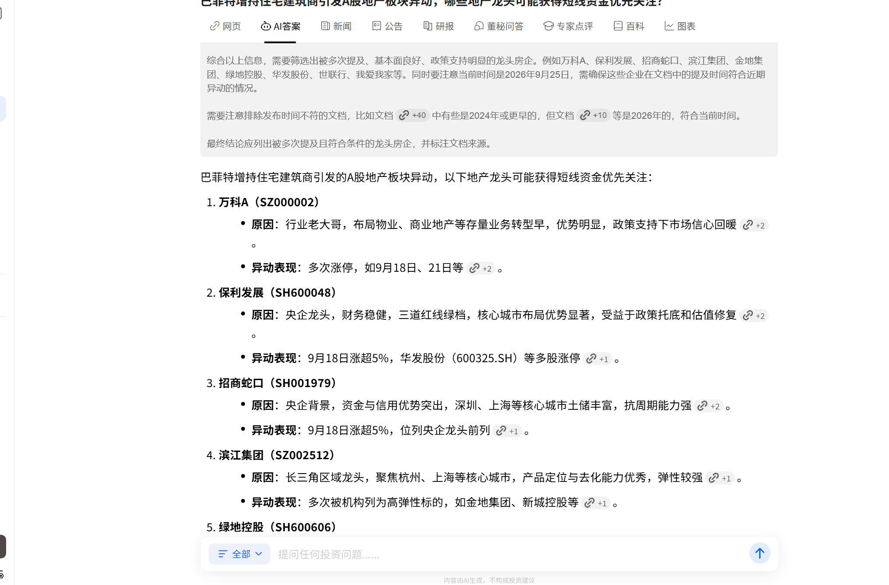
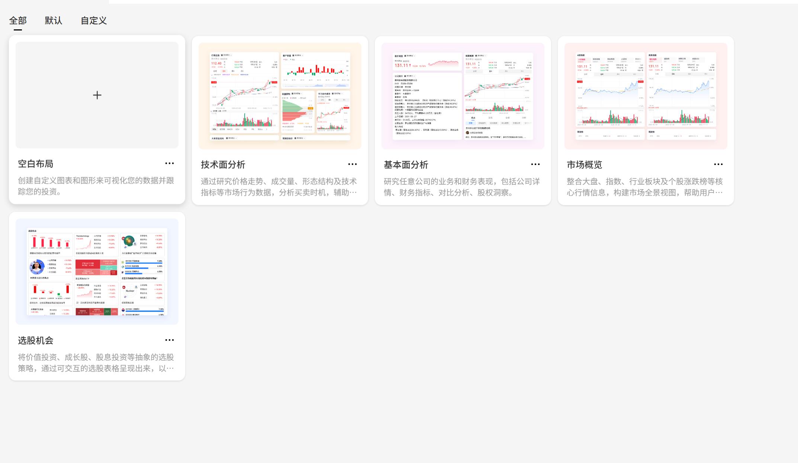
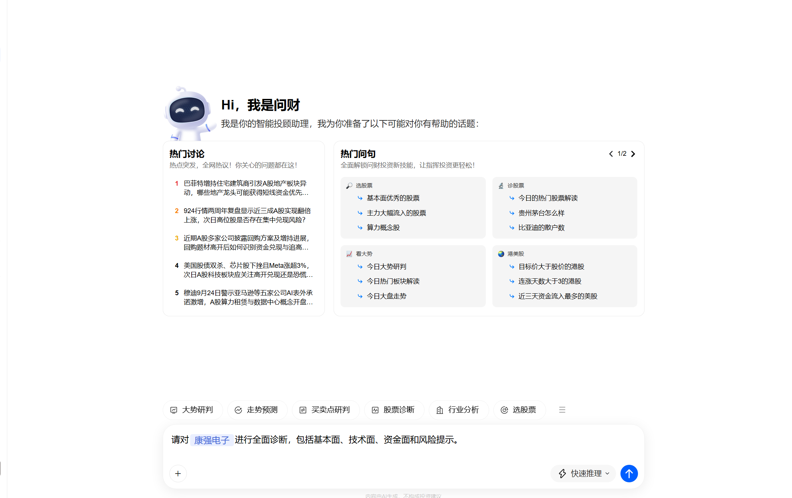
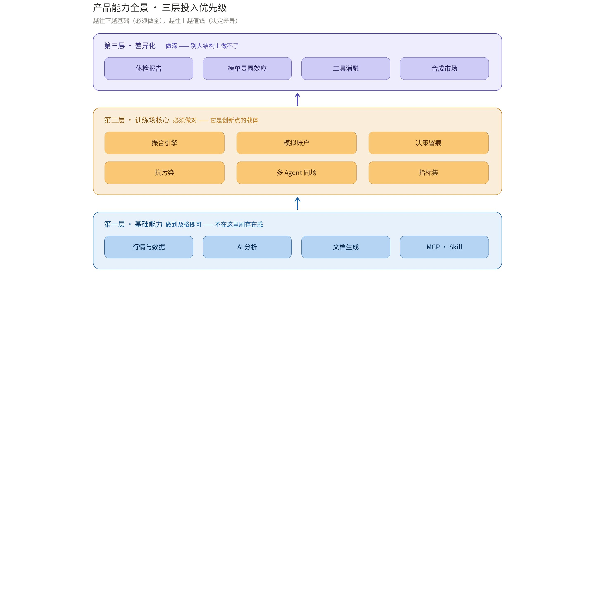
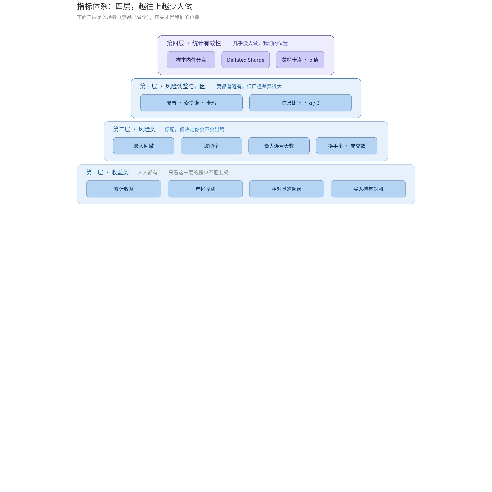
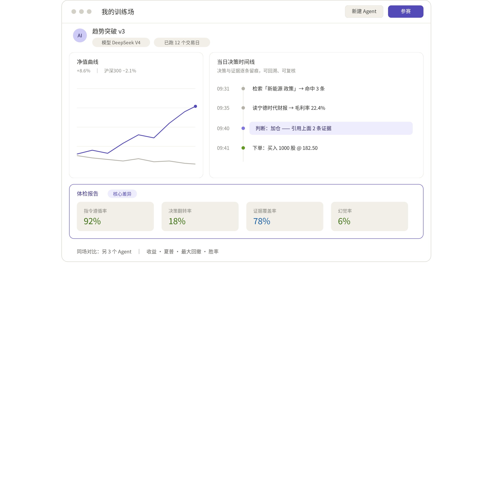

# Final Year Project：openOutcry

> 来源：https://bcnd63yb3pzy.feishu.cn/wiki/SYwXw5XH2iKfK5kXnqc6nvknlf
> 导出时间：2026-10-16 ｜ 由飞书知识库导出为 Markdown

---

## 1.一句话定位：

LLM 交易 Agent 评测与训练设施：训练场开放接入任意投资 Agent（内置开箱即用 Agent 是默认路径，ZCode、Kimi、Codex、TradingAgents 等成熟 Agent 经适配即可下场），外加一套轻量、支持自定义的投资 Agent 架构。

## 2.竞品与市场调研

### 2.1 主流闭源竞品

| 能力 | 代表产品与现状 |
|-|-|
| AI 信息收集 | 各股票的公告、财报搜索、新闻热点搜索，各家普遍具备 |
| 行情数据 | 指数、个股涨跌幅查询，配套 K 线图 |
| AI 投资建议 | 推荐个股、给出加减仓建议（见下图问财的板块异动推荐） |
| 文档生成 | Kimi 与同花顺问财的主竞争领域：Kimi 偏 TOB（银行、投资机构），问财偏 TOC（个人投资者、自媒体） |

<grid>
<column width-ratio="0.468708">

</column>
<column width-ratio="0.531292">

</column>
</grid>

### 2.2 开源与 AI 评测类竞品：各自都停在半路

开源和学术界的 AI 投资agent与我们项目有一定重合，但它们并没提供用户可见的训练数据实例，与一个可自定义的训练场。

| 项目 / 产品 | 类型 | 做了什么 | 差什么 |
|-|-|-|-|
| TradingAgents 等开源 Agent 框架 | 开源框架 | 提供投资建议，或生成量化策略并部署 | 靠兴趣维护、只聚焦单一功能点；通用回测引擎不以 A 股规则为目标，Lean / NautilusTrader 的 T+1、涨跌停、除权都要重写 |
| [AI-Trader（港大）](https://arxiv.org/abs/2512.10971) | 学术评测 | 把 A 股纳入 LLM 交易评测 | 六个主流模型无一跑赢 SSE-50 基准；一次性测试，不是可持续设施 |
| [TraderRank](https://www.traderank.ai/llm-trading-benchmark) | 商业竞技场 | 九个赛季、2,826 笔交易的模型对战 | 仅 46.2% 模型-赛季盈利，却不报样本内外与显著性；不开放代码、无 human-in-the-loop、缺乏 A 股支持（详见 3.3） |
| 模拟盘（各行情 / 券商平台） | 产品功能 | 模拟交易本身 | 无决策留痕与交易行为分析，复盘全靠用户自己 |

### 2.3 差距总结：基础能力很难超越，评测层还空着

无论闭源还是开源竞品，长期沉淀下来，基础能力我们都很难超越——但这恰好说明正面竞争没有意义：基础能力只是入场券，真正在开源领域没任做的，是下一节的评测与训练层。

## 3.创新点

### 3.1 痛点：AI辅助投资的能力没有可量化标准

目前在github上，通过AI能力提供投资服务的开源项目主要分两类：

- 第一类，纯投资建议，帮你分析行情热点/该加仓还是该减仓/实事热点等
- 第二类，基于量化交易，通过AI生成量化交易策略并部署。

无论是哪一类，都面临一个问题：怎么去评判AI的成果？假如我根据AI的建议去做投资/加仓/减仓，我能不能赚钱？

### 3.2 从这一痛点出发，思考：投资者到底需要什么？

- 第一，许多投资者有投资经验，但技术经验却不足，因此，需要一个开箱即用的投资agent框架，用户可灵活的修改系统提示词、引入其他skill，以此自己的投资agent；用户提供投资经验，我们提供底层能力。
- 第二，有了投资agent后，还需要一个训练场，让用户看到使用投资agent指定的策略做投资最终的效果、收益率如何，如何根据过程中的操作训练结果做针对性的数据分析和优化；如何比较不同投资策略最终在收益率上的优劣等等问题。
- 第三，投资 Agent 不是只有我们一家：ZCode、Kimi、Codex、TradingAgents 等成熟 Agent 已被大量用户日常使用。用户不一定愿意为了一个「训练场」放弃顺手的工具——所以训练场要能把这些现成的 Agent 原样接进来，让用户带着已有的 Agent 直接进场，而不是逼他们迁移到我们的框架里。

所以，我们最终决定做：

一套**公开、可持续运行**的 LLM 交易 Agent 评测与训练设施：用户提交自己配置的投资 Agent——用我们的轻量框架拼装，或直接接入 ZCode、Kimi、Codex、TradingAgents 等现成 Agent——它在抗污染的 A 股历史与实时数据上自主研究、决策、下单，最后交出**可核验的成绩与决策档案**。

### 3.3 竞品功能分析

现在已经有许多产品做了模拟盘服务，但它们并不是我们要实现的训练场：只提供了在模拟盘上投资交易本身的能力，而没有对交易行为的记录和数据分析，依赖用户自己去做复盘提升。

也有一些产品在研究 AI 的投资能力，如 [TraderRank](https://www.traderank.ai/llm-trading-benchmark)，但它做的并不是我们刚说的产品：

- 它不开放底层源代码，普通投资者只能看，不能用；
- 本质上，它做的只是研究 AI 模型在某个 agent 框架下的投资能力，对普通投资者的实际帮助几乎没有——普通投资者并不能单单看比赛结果，就知道自己该怎么用 AI agent 去辅助投资；
- 没有 human-in-the-loop：TraderRank完全由AI进行投资决策，我们的训练场支持人与AI多轮对话，最终看效果。
- 缺乏对 A 股的支持，主要围绕加密货币和部分美股。

同时，根据调研，各大闭源竞品确实也有使用历史股市数据对agent进行训练，但问题在于：并不开源，用户不可感。而我们的训练场直接面向使用agent的用户本身。

我们的训练场，并不服务于agent，更是直接服务于用户，让他们有更充分的信心使用agent进入市场。

## 4.功能实现

#### 4.1 第一层 · 基础能力（入场券）

开源、闭源竞品都有，我们也必须有，但我们比较难做出创新/做的比它们好。

| 能力 | 具体内容 |
|-|-|
| 行情与数据 | A 股 / 港股 / 美股实时行情、K 线、财报、公告、新闻；接开源接口，支持 BYOK，字段级标注来源 |
| MCP / Skill | 作为第三方能力的接入协议 |

#### 4.2 第二层 · 训练场核心（地基）

| 能力 | 要做到什么程度 |
|-|-|
| 引擎 | A 股规则正确：T+1、涨跌停、集合竞价、手续费与印花税、分红送转除权 |
| 模拟账户 | 现金账本、持仓、净值曲线、真实成本模型 |
| 决策留痕 | 每次决策的理由、依据、工具调用、结果，全量 append-only 记录 |
| 抗污染 | 预训练语料里就有历史行情（语料污染），模型可能背过答案，评测先抗污染：时点掩码 + 日期 / 公司匿名化（可选，按需开启）+ 可回放 |
| 多 Agent 同场 | 统一初始资金与规则、隔离账户、实时排名；配合开放接入（见下），参赛者不限于内置 Agent |
| 指标集 | 收益、夏普、最大回撤、胜率，外加四个过程指标 |

#### 指标体系：根据什么来评判agent的好坏

前面只列了模型行为维度，这里把交易绩效维度补上。

落到我们自己的清单，就这三类——前两类照抄，第三类是分水岭：

| 类别 | 指标 | 要注意什么 |
|-|-|-|
| 收益类 | 累计收益、年化收益、相对基准超额、买入持有对照 | 基准必须同期同市场，A 股默认沪深 300 |
| 风险类 | 最大回撤、波动率、最大连亏天数、换手率、成交次数 | 只看收益不看回撤等于没看 |
| 风险调整与归因 | 夏普、索提诺、卡玛、信息比率、跟踪误差、α / β | 参数必须公开：无风险利率、年化因子 |

另一条佐证：有高校团队拿 20 个大模型做了约三个月实测，结论是「模型能力与夏普比率有一定相关性，**但相关性并不高**」，且在 A 股上「AI 基本没有获得明显收益，策略表现更随机」。收益信号这么弱，所以我们的指标集要加第四层，它正好接上第 3 节的创新点：

- **样本内外分离**：同一策略在样本内、样本外的夏普分开报，不接受只报好看的那个；
- **统计显著性**：Deflated Sharpe（扣除多重检验偏差）、蒙特卡洛 prob(profit)、p 值。目前只有 frank-quant 做到，但那是一次性视频，不是持续设施；
- **最小样本量门槛**：样本不足就明写「不足以判断」，不给排名。astock 的阈值是 20，我们沿用并公开这个数字。

一句话：**别人的榜单告诉你谁赚得多，我们要在同一个榜首告诉你这个结论有多不确定。**

参考：[B 站：四家顶级大模型量化交易横评](https://www.bilibili.com/video/BV15HMS6DETZ/)｜[配套 GitHub 仓库（含 REPORT.md 与原始数据）](https://github.com/frank-quant/ai-trading-videos/tree/main/EP004_four-llm-quant-benchmark)｜[木鱼 ETF 的 AI 竞赛报道](https://finance.sina.com.cn/wm/2026-04-12/doc-inhufuye5547937.shtml)｜[20 个大模型三个月实测（高校团队）](https://www.163.com/dy/article/KT80L44T05568W0A.html)

#### 开放接入：训练场支持任意投资 Agent

前两层的默认主角是我们那个开箱即用的 Agent——它让没有技术经验的投资者零门槛进场。但训练场如果只能运行我们自己框架造出来的 Agent，它就只是一个产品功能；只有外部的成熟 Agent 也能进来，它才是 2.2 节说的「开放参赛」的公共设施。市面上的投资 Agent 并不止我们一家：ZCode、Kimi、Codex、TradingAgents 等成熟 Agent 已经被大量用户日常使用。因此训练场对这些 Agent 的实现方式不做任何假设，只约定输入、输出两个断面，按三类方式接入：

| 接入方式 | 说明 |
|-|-|
| 内置 Agent · 默认路径 | 我们的开箱即用框架：改提示词、挂 Skill 即得一个可下场的投资 Agent，新用户从这里起步 |
| 成熟 Agent · 官方适配器 | 为 ZCode、Kimi、Codex、TradingAgents 等各维护一个适配器，转换输入输出后即可下场，与内置 Agent 同场竞技、同榜排名 |
| 自定义 Agent · 开放协议 | 任何程序实现最小接入协议——拉取行情上下文、回传标准交易指令（标的 / 方向 / 数量 / 理由）、上报决策留痕——即可参赛，协议随项目开源 |

三类接入最终汇入同一条流水线：同一套 A 股规则引擎、同一个模拟账户、同一份决策留痕与指标集——训练场不关心 Agent 是谁写的。成本也可控：投资 Agent 的行为都是同构的「读数据 → 推理 → 下单」，需要标准化的只有输入输出两个断面，适配器的工作量集中在把各家 Agent 的输出解析成统一交易指令、并按 A 股规则（T+1、涨跌停）做下单校验。而收益直接命中竞品空白：TraderRank 只在自己的框架里测自家选的模型且不开放（见 3.3），我们把「开放参赛」落成了产品能力——用户带着顺手的 Agent 零迁移进场，榜单也从「评测我们自己写的 Agent」升级为「任意投资 Agent 的公开竞技场」。

#### 4.3 第三层 · 差异化（创新点落地）

| 功能 | 产品形态 |
|-|-|
| 体检报告 | 指令遵循率、决策翻转率、证据覆盖率、幻觉率等其他除收益率外 |
| 榜单暴露效应 | 被观察组与盲跑组并行，量化排行榜对 Agent 行为的污染 |
| 工具消融 | 抽掉某工具/某skills，看相关指标掉多少，输出可行动的结论 |
| 合成市场 | 保留 A 股统计特性但历史上不存在的走势，解决样本量 |

#### Demo · 训练场最小闭环

最小闭环走一遍：用户提交一份 Agent 配置（模型、提示词、工具集、风控闸门），或直接选择一个已适配的外部 Agent（ZCode / Kimi / Codex / TradingAgents）→ 在历史交易场上按 A 股规则跑完一段行情 → 系统产出净值曲线与逐笔决策档案，每笔买卖的理由、依据、工具调用全量可查 → 体检报告给出收益率之外的行为指标，并标注结论的置信程度：样本不足就直接写「不足以判断」，不给排名。

## 5.Timelines（进度安排）

本章节维护历史每周进展总结，并对之后的安排进行展望。

<table><colgroup><col/><col/><col/></colgroup><thead><tr><th vertical-align="top">学期</th><th vertical-align="top">周次</th><th vertical-align="top">主要工作与产出</th></tr></thead><tbody><tr><td rowspan="3" vertical-align="top">第 1 学期</td><td vertical-align="top">第 1-4 周（9 月）</td><td vertical-align="top">竞品实测与赛道定位；<b>9 月 30 日提交 Planning report</b></td></tr><tr><td vertical-align="top">第 5-8 周（10 月）</td><td vertical-align="top">竞品调研收口；完整产品文档；<b>10 月 31 日提交中间进度报告</b></td></tr><tr><td vertical-align="top">第 9-12 周（11 月至 12 月初）</td><td vertical-align="top">技术方案调研，含数据源、撮合引擎、抗污染、评测协议、Agent 接入协议；进入开发；<b>12 月 2 日提交期末报告</b></td></tr><tr><td rowspan="4" vertical-align="top">第 2 学期</td><td vertical-align="top">第 1-3 周（1 月）</td><td vertical-align="top">数据层、A 股撮合引擎、模拟账户与净值（D1）</td></tr><tr><td vertical-align="top">第 4-6 周（2 月）</td><td vertical-align="top">抗污染数据层：时点掩码、实体匿名化（D2）；决策留痕账本（D3）</td></tr><tr><td vertical-align="top">第 7-8 周（3 月上半月）</td><td vertical-align="top">指标集与体检报告、多 Agent 同场与工具消融（D4、D5）；<b>第 8 周产出：投资 Agent 在历史交易场与实时交易场上的真实收益</b></td></tr><tr><td vertical-align="top">第 9-12 周（3 月下半月至 4 月）</td><td vertical-align="top">外部 Agent 适配器接入实测（ZCode / Kimi / Codex / TradingAgents）；Demo 与复盘档案、回归测试；盲跑组与榜单暴露效应实验；开源发布与结题材料（D6）</td></tr></tbody></table>

## 6.参考与竞品链接

汇总正文涉及的竞品与项目主页，便于查证与实测。

### 开源竞品 / 相关项目

- [TradingAgents（Tauric Research）](https://github.com/TauricResearch/TradingAgents)：多 Agent 协作的 LLM 交易框架，2.2 节「开源 Agent 框架」的代表；
- [QuantDigger](https://github.com/QuantFans/quantdigger)：国产 Python 量化回测框架，支持股票 / 期货回测；
- [AI-Trader（港大 HKUDS）](https://github.com/HKUDS/AI-Trader)：LLM 交易实时评测，覆盖美股、A 股与加密货币（对应 2.2 节）；
- [FinRobot（AI4Finance Foundation）](https://github.com/AI4Finance-Foundation/FinRobot)：开源金融 AI Agent 平台；
- [Qlib（微软）](https://github.com/microsoft/qlib)：AI 导向的量化投资平台。

### 闭源竞品

- [同花顺问财](https://www.iwencai.com/)：智能选股 / 智能投顾平台，2.1 节的主要对照产品；
- [Kimi（月之暗面）](https://kimi.moonshot.cn/)：通用 AI 助手的投资分析与图表布局能力（2.1 节截图来源）。

### AI 交易评测 / 竞技场

- [TraderRank](https://www.traderank.ai/llm-trading-benchmark)：LLM 交易竞技场榜单（2.2 / 3.3 节）；
- [Alpha Arena（Nof1）](https://nof1.ai/)：真实资金的 LLM 交易竞赛，3.3 节对比表中的「已归档」项。
