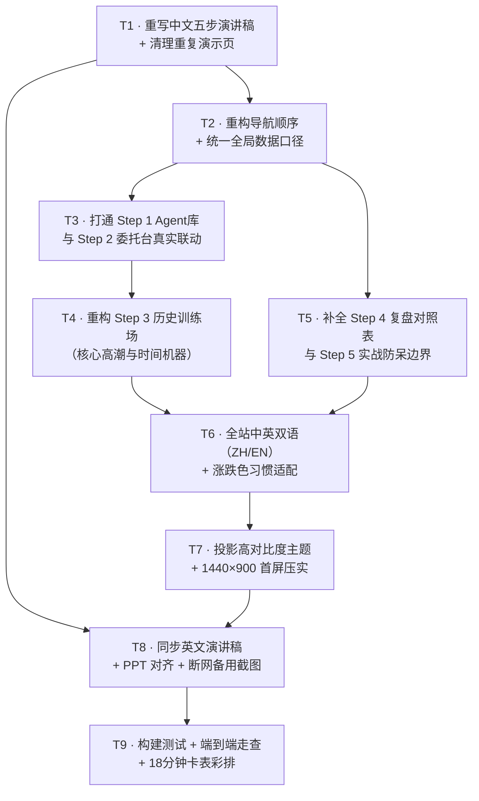

# openOutcry 期末答辩第三部分（产品演示）重构与原型改造任务清单

> **创建日期**：2026-11-26  
> **最终目标**：完善 FYP Term 1 期末答辩（2026-12-07，SHB 1037，全英文）第三部分「产品方案与线上原型走查」，同步完成 `openoutcry-web` 交互原型重构、中英双语化、历史训练场交互升级与中英文演讲稿 / PPT 对齐。  
> **参考依据**：[期末答辩完整中文演讲稿-2026-12-07.md](file:///D:/projects/playground/stock-ai-compete/final-report/期末答辩完整中文演讲稿-2026-12-07.md)、[openOutcry-产品设计与功能-MVP.md](file:///D:/projects/playground/stock-ai-compete/research/openOutcry-产品设计与功能-MVP.md)、[openOutcry-A1-前端交互设计-会话界面.md](file:///D:/projects/playground/stock-ai-compete/research/openOutcry-A1-前端交互设计-会话界面.md)、[交互竞品实测对比.md](file:///D:/projects/playground/stock-ai-compete/research/交互竞品实测对比.md)

---

## 一、已确立的三大核心设计共识

在动手执行前，先锁死以下三条共识，后续所有文档与代码改造均以此为准：

1. **五步单向因果闭环（消灭“菜单点名式功能巡演”）**：
   - `01 Agent 库 (/connect)` → `02 训练委托 (/studio)` → `03 历史训练场 (/training)` → `04 复盘与对照 (/review)` → `05 实战工作台 (/live)`。
   - `协议与 Skill` 移入第四部分架构/Q&A 与侧边栏底部「参考」分组；`产品说明` 不在真机演示中出现；删除第四部分旧版残留的重复演示页（原 `Slide 18`）。
2. **Step 3「历史训练场」的时间粒度与核心交互定调**：
   - **MVP 落地口径**：采用**日频三阶段**（`09:15 盘前研究（禁下单） → 09:30 开盘撮合 → 15:00 尾盘结算`），主屏显式呈现模拟时钟、阶段推进灯、PIT 时点截断与双盲实体匿名（`公司-017`）、PIT 截断走势条、A 股确定性规则预检与“批准 ≠ 成交”状态机联动。
   - **目标架构口径（快慢双时钟解耦）**：慢时钟（LLM Agent）负责低频语义研究、条件单制定与异常事件唤醒；快时钟（确定性代码引擎）负责分钟级行情扫描、限价/止损触发顺序撮合与盘中异动监控（在委托台口径与第四部分架构/Q&A 中讲清）。
3. **学术诚实与答辩硬环境边界**：
   - 明确声明前端原型使用虚构演示数据与确定性前端状态机，不冒充已验证的真实历史回测引擎或实盘券商接口。
   - 正式答辩为全英文且在教室大屏投影，必须补齐 **中英双语切换（含涨跌色习惯适配）** 与 **投影高对比度可读性**。

---

## 二、任务依赖关系图（执行顺序总览）

### 为什么必须按这个顺序排？（避免返工的关键依赖）
- **先 `T1`（中文剧本）再 `T2–T5`（改原型）**：先定死 5 步走查台词与每一个要点击的视觉锚点，改代码时才不会做无用功或漏掉演示点。
- **先 `T2–T5`（改完结构与文案）再 `T6`（做双语 i18n）**：如果先做 i18n 再重构历史训练场、对照表和委托台，每改一次中文界面都要同步改英文词典，返工成本翻倍；等所有中文界面和文案定型后统一抽离词典最省力、最不容易漏译。
- **先 `T6–T7`（英文原型定型）再 `T8–T9`（英文稿、PPT 与彩排）**：英文演讲稿里的界面名词、按钮文案和 PPT 静态兜底截图，必须与最终跑通的英文版网页原型 100% 一致。

---

## 三、按顺序排列的任务明细

### 阶段一：锁定叙事剧本

#### [x] T1｜重写中文演讲稿第三部分（五步闭环）并清理第四部分重复演示
- **前置依赖**：无（调研与时间粒度定调已完成）
- **目标**：把第三部分从“7 页功能巡演”改写为“一个投资 Agent 通过 5 步考核上岗”的单向因果故事，把 Step 3（历史训练场）打造成 90 秒核心高潮，并清理全稿冗余。
- **核心改动**：
  - 按 `01 Agent 库 → 02 训练委托 → 03 历史训练场（四拍高潮）→ 04 复盘与对照 → 05 实战工作台` 重写第三部分走查脚本（控制在 3.5–4 分钟）；
  - 将 `协议与 Skill` 移出第三部分，归入第四部分架构说明/Q&A；移除 `产品说明 (MDX)` 走查段落；
  - 删除第四部分残留的旧版重复演示 `Slide 18`，重排后续幻灯片编号；
  - 在第四部分补充「快慢双时钟解耦（日频三阶段 MVP + 分钟级确定性撮合演进）」作为架构取舍或 Q&A 防守弹药。
- **涉及文件**：[期末答辩完整中文演讲稿-2026-12-07.md](file:///D:/projects/playground/stock-ai-compete/final-report/期末答辩完整中文演讲稿-2026-12-07.md)
- **完成标准（DoD）**：中文稿第三部分走查轨迹严格单向（`01 → 02 → 03 → 04 → 05`），全场无重复演示页，每个舞台提示都能对应到明确的目标 UI 元素。

---

### 阶段二：重构原型骨架与核心交互

#### [ ] T2｜重构信息架构、导航顺序与全局数据口径统一
- **前置依赖**：`T1`
- **目标**：消灭演示时的“跳格子”点击路径、左侧栏冗余与跨页数字打架。
- **核心改动**：
  - 重排 [routes.ts](file:///D:/projects/playground/stock-ai-compete/openoutcry-web/src/app/routes.ts)：主流程 5 项顺排为 `01 Agent 库 (/connect)`、`02 训练委托 (/studio)`、`03 历史训练场 (/training)`、`04 复盘与对照 (/review)`、`05 实战工作台 (/live)`，默认落点对齐演示或工作流起点；
  - 调整 [Sidebar.tsx](file:///D:/projects/playground/stock-ai-compete/openoutcry-web/src/components/chrome/Sidebar.tsx)：将 `协议与 Skill`、`产品说明` 降权放到侧边栏底部「参考」分组（去掉序号）；去掉顶部与主菜单重复的 `+ 新建训练`；去掉点切换只改标题不换内容的假子会话层级；优化任务树排序（训练任务优先或在对应工作区展开）；
  - 清理 [GuidePage.tsx](file:///D:/projects/playground/stock-ai-compete/openoutcry-web/src/routes/GuidePage.tsx) 中 `Product Spec (MDX)` 等内部研发术语；
  - 统一 [agents.ts](file:///D:/projects/playground/stock-ai-compete/openoutcry-web/src/data/agents.ts)、[trainings.ts](file:///D:/projects/playground/stock-ai-compete/openoutcry-web/src/data/trainings.ts)、[run.ts](file:///D:/projects/playground/stock-ai-compete/openoutcry-web/src/data/run.ts)、[ReviewPage.tsx](file:///D:/projects/playground/stock-ai-compete/openoutcry-web/src/routes/ReviewPage.tsx) 中的 `initialCash`、日期窗口、交易日进度与净值图横轴口径。
- **完成标准（DoD）**：侧边栏自上而下点击即可走完五步主线；跨页检查资金、日期与交易日数完全自洽，无假切换入口。

#### [ ] T3｜打通 Step 1（Agent 库）与 Step 2（训练委托）首屏与真实联动
- **前置依赖**：`T2`
- **目标**：让前两步从“局部假状态 + 长页滚屏”变成“一屏可读 + 真实传参进训练场”。
- **核心改动**：
  - **Step 1（[ConnectPage.tsx](file:///D:/projects/playground/stock-ai-compete/openoutcry-web/src/routes/ConnectPage.tsx)）**：改为“左 Agent 列表 + 右 Agent 卡配置/JSON”主从一屏布局；「接入新 Agent」三步向导收进 Modal/Drawer，提供可复制的真实接入 Prompt / CLI 双页签；握手完成后主按钮引导前往 `/studio`（训练委托台）而非跳过委托台直奔 `/training`；
  - **Step 2（[MandateTicket.tsx](file:///D:/projects/playground/stock-ai-compete/openoutcry-web/src/components/studio/MandateTicket.tsx) & [TrainingLedger.tsx](file:///D:/projects/playground/stock-ai-compete/openoutcry-web/src/components/studio/TrainingLedger.tsx)）**：压缩顶部 Hero 高度，让 2×2 委托单与提交按钮完整落在 1440×900 首屏内；在规则格补上 `决策节拍：日频三阶段（盘前/开盘/尾盘）` 口径；将委托单表单状态接入全局 store，点击「开具委托单」真实创建 `№ 0043` 加入台账，并将选中的 Agent 团队（1–3 位及分工）、时段与模式真实带入历史训练场；点击历史台账行能正确切换对应任务。
- **完成标准（DoD）**：在 Agent 库完成握手可顺滑进入委托台；在委托台勾选 2 位 Agent 开具委托单后，训练台账新增 `№ 0043`，进入训练场顶部与左栏能真实读出所选团队与口径。

#### [ ] T4｜重构 Step 3「历史训练场」核心交互逻辑（全片核心高潮）
- **前置依赖**：`T2`、`T3`
- **目标**：把“护城河”从抽屉搬回主屏，打造真实模拟盘的“时间机器 + 抗污染证据 + 规则闸门 + 人机协同”高潮体验。
- **核心改动**：
  1. **顶部常驻「时间机器与合规仪器带」**（[WorkbenchPane.tsx](file:///D:/projects/playground/stock-ai-compete/openoutcry-web/src/components/training/WorkbenchPane.tsx)）：
     - 显式展示交易日进度（`Day 3 / 20 · 2024-04-23 (D+0)`）与可跳变的**三阶段推进灯**（`09:15 盘前研究 → 09:30 开盘撮合 → 15:00 尾盘结算`）；
     - 显式展示抗污染双盾牌：`🔒 PIT 截止 04-22 23:59` 与 `🛡 双盲匿名（公司-017）`；
     - 显式展示协作模式切换（`逐案审批 (HITL)` ⇄ `/goal 自主推进`）及所选团队成员（单执行者委员会语义）。
  2. **左栏升级为「阶段化可审计轨迹流」**（[ConversationPane.tsx](file:///D:/projects/playground/stock-ai-compete/openoutcry-web/src/components/training/ConversationPane.tsx)）：
     - 插入交易日/阶段分隔条（`day-divider`），推进阶段时自动追加新分隔条；
     - 增加轻量筛选条（`全部 / 思考 / 工具 / 提案 / 人工`）与「暂停滚动」开关；
     - 工具调用条展开升级为 **PIT 证据卡**：展示证据编号（`ev_018 / ev_024`）、发布时间与 `✅ PIT 合格` 标记，并附一行时点闸门拦截提示（*“已拦截 2 条 04-23 盘后披露，未返回给 Agent”*）；
     - 修正黄色等待提示框里的内部注释文案（删掉“这里不再重复放按钮”）；保留人工插话与 `/goal`。
  3. **右栏升级为「真实模拟盘撮合闭环」**（[ProposalTicket.tsx](file:///D:/projects/playground/stock-ai-compete/openoutcry-web/src/components/proposal/ProposalTicket.tsx) & [RunProvider.tsx](file:///D:/projects/playground/stock-ai-compete/openoutcry-web/src/store/RunProvider.tsx)）：
     - 新增紧凑的 **「标的 PIT 截断走势条」**（轻量 SVG）：展示 `公司-017` 近期收盘走势 + 成本线 + 垂直虚线 `PIT 截止 04-22` + 右侧半透明遮罩（`04-23 开盘尚未揭示`）；点击撮合后遮罩解开，实时渲染 `04-23` 开盘价（¥20.36）与成交标记；
     - 提案卡增加 **A 股确定性规则预检条**（`✓ 100股整手 · ✓ T+1可卖600股 · ✓ ±10%涨跌停内 · 预计费用 ¥7`）；
     - 批准按钮可附 3 秒可撤销 toast，批准后账户现金/持仓**零变化**；将「演示开盘撮合」改名为 **「推进至 09:30 开盘撮合 →」**；
     - 撮合完成后，自然展示下一步出口：**「推进至 15:00 尾盘结算」** 或 **「`/goal` 跑完剩余 17 日 → 前往复盘」**。
- **完成标准（DoD）**：现场演示能完整走通 `09:15 盘前看 PIT 证据 → 批准（账户不变）→ 推进至 09:30 开盘撮合（阶段灯跳变 + 截断走势解锁 + 四页签账本同步刷新）→ 推进/前往复盘`，全程零出戏文案。

#### [ ] T5｜补全 Step 4「复盘与对照」与 Step 5「实战工作台」边界打磨
- **前置依赖**：`T2`、`T3`（可与 `T4` 并行或在 `T4` 之后紧接执行）
- **目标**：让第三项核心需求「可重复对照」有可视化实锤，同时让「训战一体」的模拟/实盘防呆边界无懈可击。
- **核心改动**：
  - **Step 4（[ReviewPage.tsx](file:///D:/projects/playground/stock-ai-compete/openoutcry-web/src/routes/ReviewPage.tsx) & [AgentConfigDialog.tsx](file:///D:/projects/playground/stock-ai-compete/openoutcry-web/src/components/dialogs/AgentConfigDialog.tsx)）**：
    - 落地已备样式的 `.compare-table`，展示 **同口径多版本对照（Run A vs Run B：锁死同一区间、资金与规则，只改单一变量如止损阈值/模型，并列对比收益、相对沪深 300、最大回撤、成交数与费用）**；
    - 升级「复制配置重跑」弹窗：明确显示“已锁定的实验口径（时段/标的池/初始资金/费率）”+“本次可修改的单一变量（模型/提示词/风控上限）”并支持触发新对照运行；
    - 保留「样本不足（20/60 交易日）· 不排名」徽章、逐笔证据溯源（建议三段折叠：观察 / 思考 / 动作）与一键「应用到实战工作台」。
  - **Step 5（[LiveWorkbenchPage.tsx](file:///D:/projects/playground/stock-ai-compete/openoutcry-web/src/routes/LiveWorkbenchPage.tsx) & [live.ts](file:///D:/projects/playground/stock-ai-compete/openoutcry-web/src/data/live.ts)）**：
    - 顶部加醒目的绿色实盘安全边界提示条（`LIVE · 实盘辅助 · 仅给建议不代下单 · 镜像台账手动维护`），与模拟盘拉开视觉防呆层级；
    - 把首条“当前为 MVP 轻量手动维护模式……”从**用户气泡**改为**系统状态提示条**；
    - 调仓建议单去掉下单样式的 `−/+` 步进器，操作收敛为 **`按建议记账` / `按实际录入` / `暂不采纳`**，强化“AI 原始建议与人类实盘操作分开留档”。
- **完成标准（DoD）**：复盘页能一眼证明“同口径单变量对照”如何把策略能力和行情运气拆开；实战工作台不再像模拟盘的换皮，无任何“误导像在直接下真单”的控件。

---

### 阶段三：双语化与教室投影适配

#### [ ] T6｜实现全站中英双语（`ZH / EN`）切换与涨跌色习惯适配
- **前置依赖**：`T2`、`T3`、`T4`、`T5` 全部定型
- **目标**：满足 2026-12-07 全英文答辩硬要求，让国际评委在大屏上无障碍跟上每一步点击与数据变化。
- **核心改动**：
  - 引入轻量 `LocaleProvider`（`zh` / `en`）与全局切换开关（放在侧边栏底部或顶栏固定位置，支持 URL 参数如 `?lang=en` 默认进英文态，方便答辩提前开好 Tab）；
  - 覆盖主线 5 页、侧边栏导航、所有弹窗、状态机追加的事件流文案（`RunProvider.tsx`）、图表标题与印章文案；
  - **涨跌色与币种习惯处理**：中文模式默认 A 股「红涨绿跌」，英文模式自动切为国际习惯「绿涨红跌」（或在切换开关旁提供明确图例/独立开关），避免评委看到红色 `+$3,762.60` 产生误解。
- **完成标准（DoD）**：切到 `EN` 模式走完 `01 → 02 → 03 → 04 → 05`（含点击批准、撮合、弹窗、切页签、跳转实战），屏幕上**零残留中文硬编码**，数字与涨跌色清晰无歧义。

#### [ ] T7｜投影高对比度主题与首屏分辨率适配（SHB 1037 物理环境保障）
- **前置依赖**：`T4`、`T5`、`T6`
- **目标**：解决“白底瑞士风 PPT 切到极暗墨绿 Web 在明亮教室投影仪上发灰糊成一片”的风险。
- **核心改动**：
  - 在 [tokens.css](file:///D:/projects/playground/stock-ai-compete/openoutcry-web/src/styles/tokens.css) 增加**高对比/亮色演示主题切换开关**（支持一键切换或 `?theme=light`），并同步调高暗色模式下 `--fg-2` 次级文本与分割线对比度；
  - 在 `1440×900` 与 `1280×720`（常见教室投影分辨率）下逐页核查主线 5 页，确保核心操作区尽量落在首屏内，消灭演示中的频繁上下滚屏。
- **完成标准（DoD）**：亮色/高对比主题下 5 个主页面文字、表格线、SVG 图表与印章清晰锐利；在 1280×720 与 1440×900 下演示动线顺畅。

---

### 阶段四：演讲稿定稿、PPT 对齐与彩排验收

#### [ ] T8｜同步更新英文演讲稿、PPT 页面与静态兜底截图
- **前置依赖**：`T1`、`T6`、`T7`
- **目标**：确保英文口播稿、PPT 幻灯片与线上英文原型 100% 同频，并备好现场断网兜底方案。
- **核心改动**：
  - 按定稿后的中文稿与英文版原型界面名词，重写 [期末答辩完整英文演讲稿-2026-12-07.md](file:///D:/projects/playground/stock-ai-compete/final-report/期末答辩完整英文演讲稿-2026-12-07.md) 第三、四部分；
  - 同步更新 `final-report/slides-full-swiss/` 对应幻灯片页码、跳转入口与讲者备注；
  - 截取英文高对比度版主线 5 页（含训练场撮合前后状态）高清截图，做成断网/现场异常时的备用演示页。
- **完成标准（DoD）**：英文稿中提到的每一个按钮、标签、数字与英文原型完全一致；PPT 与备用截图就绪。

#### [ ] T9｜工程构建检查、端到端冒烟与 18 分钟卡表彩排
- **前置依赖**：`T8`
- **目标**：确保答辩当天零报错、不超时（评分表中 `Time Keeping` 单独占 3 分）。
- **核心改动**：
  - 运行 `openoutcry-web` 的 TypeScript 类型检查、单元测试与生产构建（`npm run build`），确认无警告与断链；
  - 用英文模式从头到尾实机走查 2 遍（含 `?lang=en&theme=light` 预置 URL）；
  - 全程英文计时彩排，确保第三部分原型演示稳定在 **3 分 30 秒 – 4 分钟**，整场演讲稳定在 **17 – 18 分钟**（留足缓冲不触碰 20 分钟红线）；有条件提前到 SHB 1037 实测投影清晰度。
- **完成标准（DoD）**：构建测试全绿；连续 2 次卡表彩排零卡壳、时间落点精准。

---

## 四、执行进度总表

| 编号 | 阶段 | 任务名称 | 依赖 | 状态 |
|---|---|---|---|---|
| **T1** | 叙事锁定 | 重写中文五步演讲稿 + 清理重复演示页 | — | ✅ 已完成 |
| **T2** | 原型骨架 | 重构导航顺序 + 清理假入口 + 统一全局数据口径 | T1 | ✅ 已完成 |
| **T3** | 原型骨架 | 打通 Step 1 Agent 库与 Step 2 委托台首屏及真实联动 | T2 | ✅ 已完成 |
| **T4** | 核心高潮 | 重构 Step 3 历史训练场（时钟阶段灯/PIT 证据卡/截断走势/规则预检） | T2, T3 | ✅ 已完成 |
| **T5** | 闭环补齐 | 补全 Step 4 同口径对照表 + Step 5 实战工作台防呆打磨 | T2, T3 | ✅ 已完成 |
| **T6** | 答辩适配 | 实现全站中英双语（ZH/EN）切换 + 涨跌色习惯适配 | T2–T5 | ✅ 已完成 |
| **T7** | 答辩适配 | 投影高对比度/亮色主题开关 + 首屏分辨率压实 | T4–T6 | ✅ 已完成 |
| **T8** | 交付对齐 | 同步英文演讲稿 + PPT 页面对齐 + 静态兜底截图 | T1, T6, T7 | ⬜ 待开始 |
| **T9** | 验收彩排 | 构建与端到端冒烟测试 + 18 分钟卡表彩排 | T8 | ⬜ 待开始 |
