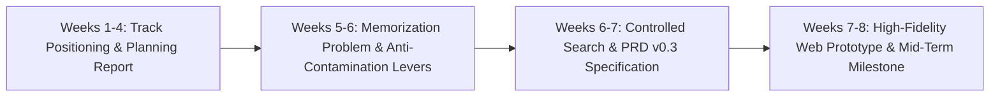
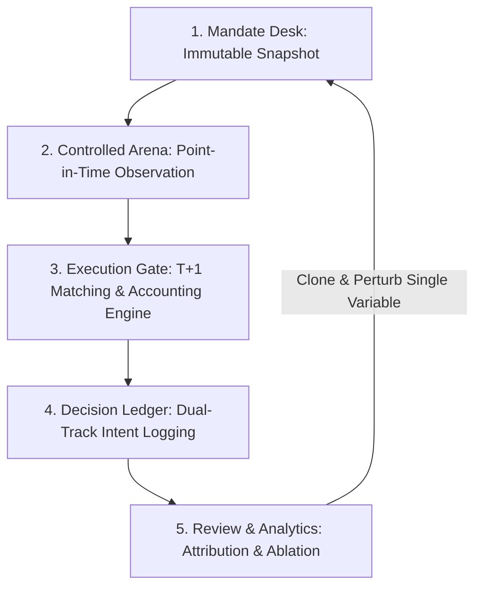
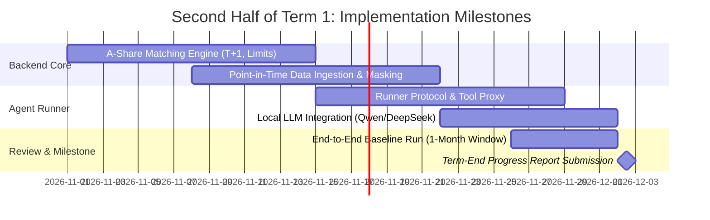

# FYP Mid-Term Progress Report: openOutcry — An Evaluation and Training Ground for LLM Trading Agents on A-shares

**Project Code:** QXU2602  
**Project Title:** openOutcry: An Evaluation and Training Ground for LLM Trading Agents on A-shares  
**Student Name:** JIAO, Haonan  
**Student ID:** 1155211226  
**Supervisor:** Prof. XU, Qiang  
**Department:** Department of Computer Science and Engineering, The Chinese University of Hong Kong  
**Academic Year & Term:** 2026–2027, Term 1 (Mid-Term Milestone: Weeks 1–8)  
**Date of Submission:** October 31, 2026  

---

## Abstract

This mid-term report presents the progress of the Final Year Project **openOutcry** (Project Code: QXU2602) across Weeks 1 to 8 of Term 1. The objective of openOutcry is to establish a public, reproducible, and contamination-resistant evaluation and training facility for Large Language Model (LLM) trading agents operating in China's A-share equity market. 

During the first half of Term 1, we have: (1) completed an in-depth literature and market investigation into the "memorization problem" and look-ahead bias in financial LLMs, formulating a formal five-lever anti-contamination framework; (2) specified the complete product workflow and architectural model, evolving from an isolated parameter form into a structured **Mandate Desk** and **Controlled Arena** paradigm; (3) authored the full Product Requirements Document (PRD v0.3) and a formal Controlled Historical Search specification with point-in-time constraints; and (4) built a high-fidelity, interactive, three-pane workbench prototype (`openoutcry-web`) implementing real-time accounting, human-in-the-loop order modification with intent preservation, and post-trade tool ablation analytics. All scheduled milestones for Weeks 1–8 have been met on or ahead of schedule, laying a concrete engineering and theoretical foundation for the backend matching engine and live runner integration scheduled for Weeks 9–12.

---

## 1. Project Overview & Objectives (Review of Planning Phase)

### 1.1 Project Goal & Scope
The fundamental goal of **openOutcry** is to build a **public, continuously running evaluation and training facility for LLM trading agents on China's A-share market**. 

Users submit their investment agent configuration—encompassing base models, system prompts, research tools, and risk-control gates. The facility places the agent within strictly controlled, immutable historical market snapshots, allows it to autonomously conduct research and formulate trading decisions using only point-in-time information, matches orders under realistic A-share exchange rules, and outputs **verifiable scorecards alongside full decision traces**.

**Explicit Boundaries (Out of Scope):**
- Direct connection to live brokerage accounts or execution of real-money orders.
- Generic, unconstrained backtesting engines that ignore market microstructure.
- Point-in-time stock recommendation services for retail speculation.

### 1.2 Target Success Criteria
As established in the initial Planning Report submitted on September 30, 2026, the project defines overall success through three discriminating criteria:
1. **A Demonstrable Closed Loop**: An agent configuration runs through an extended simulated trading period, producing an unforgeable equity curve and a per-trade decision record.
2. **Discriminating Results on Behavioral Stability**: Showing that competing models with comparable nominal returns exhibit measurable divergence in decision reversal rates, hallucination under stress, and risk-rule compliance.
3. **Honest Uncertainty Representation**: Statistical uncertainty is explicitly reported; runs with insufficient sample size or trade count are labelled "insufficient evidence" rather than ranked prematurely.

### 1.3 Core Deliverables Roadmap
The project decomposes into six primary deliverables across the two academic terms:
- **D1: A-share Matching and Accounting Engine**: Rule-correct T+1 settlement, price limits ($pm 10\%, pm 20\%$, ST limits), round-lot constraints, dividend adjustment, and transaction fees.
- **D2: Contamination-Resistant Data Layer**: Point-in-time masking at all data exits, deterministic date/entity anonymization, and post-run leakage auditing.
- **D3: Decision Ledger & Audit Trace**: Persistent logging of raw reasoning, tool invocations, evidence citations, original order intents, and human approvals.
- **D4: Multi-Dimensional Metric Set & Health Report**: In-sample vs. out-of-sample temporal separation, Deflated Sharpe Ratio (DSR), and process-level reliability metrics.
- **D5: Multi-Agent Co-Trading & Tool Ablation**: Collaborative pipeline architectures (Trading, Research, Risk Control) and systematic ablation of research tool access.
- **D6: Complete Interactive Platform & Open-Source Repository**: End-to-end web console, agent runner protocol, reproducible replay artifacts, and benchmarking suite.

---

## 2. Work Completed in Weeks 1–8 (Mid-Term Milestones)

During Weeks 1 to 8 (September to October 2026), project execution focused on four interconnected areas: competitive teardown, contamination formalization, system architecture specification, and interactive prototype implementation.



### 2.1 Problem Formalization: The Memorization Problem & Anti-Contamination Levers
In Weeks 5 and 6, we conducted a systematic empirical and literature investigation into why traditional LLM financial backtesting is systematically untrustworthy.

#### Empirical Literature Evidence
- **The Memorization Problem** (*arXiv:2504.14765*, *QuantPedia*, 2025): LLM pre-training corpora (encompassing BloombergGPT's 363B financial tokens, Tonghuashun HithinkGPT's trillions of tokens, Dongcai Miaoxiang, etc.) naturally absorb macro variables, quarterly reports, and historical price sequences. When prompted to "predict" or "trade" within historical windows, models frequently retrieve memorized outcomes rather than engaging in counterfactual economic reasoning, producing artificially inflated in-sample Sharpe ratios that fail catastrophically out-of-sample.
- **Look-Ahead Bias Benchmark** (*Look-Ahead-Bench, arXiv:2601.13770*, 2026): Confirmed that models can recite exact post-event revenue figures and stock movements when historical dates are visible, proving that prompt-based instructions ("do not use future data") are physically incapable of preventing temporal leakage.

#### The Five Anti-Contamination Levers
To transform subjective backtesting into an objective scientific benchmark, we formulated five operational levers as platform-level controls:
1. **Hard Point-in-Time Masking (`point_in_time_masking`)**: For any simulated trading day $D$, all external research tools, financial statements, and news queries are truncated to $D-1$ 23:59:59 (Beijing Time) at the data egress layer. Future data is physically excluded from model context.
2. **Deterministic Date & Entity Anonymization (`anonymize_dates`, `anonymize_entities`)**: In strict evaluation mode, absolute dates are converted into relative trading-day offsets ($T_0, T_1, \dots$). Company tickers and names are mapped to reversible pseudonyms (e.g., `Company-A089`) while preserving industry sector codes and board-specific trading rules (e.g., ChiNext 300xxx, STAR 688xxx).
3. **Temporal In-Sample / Out-of-Sample Separation (`eval_window`)**: Mandatory registration of model pre-training cutoffs. Formal leaderboard evaluations require rolling post-cutoff test windows with purge and embargo periods to eliminate train-test overlap.
4. **Deflated Sharpe Ratio (`ranking_metric = dsr`)**: Correcting for multiple hypothesis testing. When users iterate on prompt variations or hyperparameters, the Sharpe threshold is discounted based on the variance and skewness of trial returns.
5. **Minimum Sample Size Threshold (`ranking_min_samples`)**: Mandating a minimum of 20 active trading days and 15 closed transactions before issuing an official ranking. Runs with insufficient trades are labelled "Insufficient Evidence" rather than generating noisy scores.

---

### 2.2 Product Definition & System Architecture (PRD v0.3)
In Weeks 6 and 7, we finalized the comprehensive Product Requirements Document (PRD v0.3) for the openOutcry MVP. The architecture establishes a closed-loop operating lifecycle:



#### The Mandate Model
A trading simulation is defined not as an arbitrary chat session, but as an immutable 4-tuple snapshot:
$$\text{Mandate} = \langle T_{\text{window}}, U_{\text{universe}}, \text{Team}_{\text{agents}}, R_{\text{rules}} \rangle$$
- **Time Window ($T_{\text{window}}$)**: Fixed start and end dates. Once locked, the simulation clock advances strictly forward in discrete trading-day steps.
- **Asset Universe ($U_{\text{universe}}$)**: A curated basket of A-share equities (e.g., CSI 300 constituents, sector baskets).
- **Agent Team Allocation ($	ext{Team}_{\text{agents}}$)**: Decomposing trading operations into specialized roles:
  - *Research Agent*: Gathers fundamental news, calculates indicators, and extracts sentiment.
  - *Trading Agent*: Formulates position sizing, target price limits, and direction (Buy/Sell).
  - *Risk Gate Agent*: Verifies portfolio drawdown, sector concentration, and cash reserves before submission.
- **Rule Engine Parameters ($R_{\text{rules}}$)**: Initial capital, execution mode (Autonomous vs. Step-by-Step Approval), and exchange fee schedules.

---

### 2.3 Controlled Historical Search & Information Environment Design
Documented in *Controlled Search Tool Specification v0.2*, we specified the platform-managed information egress:
- **Unified `historical_search` Interface**: Rather than permitting arbitrary Internet web browsing, the agent interacts solely with a sandboxed retrieval endpoint.
- **Payload Schema**: Returns structured records: `{ evidence_id, title, published_at, snippet, full_text_ref }`.
- **Zero-Leakage Empty Responses**: Queries touching events after the temporal cutoff, queries with zero hits, and invalid ticker queries all return identical neutral empty structures (`{ hits: [] }`). The system strictly avoids emitting error messages such as *"Results exist but were filtered by date"*, which would otherwise leak future volatility information.

---

### 2.4 Interactive Prototype Implementation (`openoutcry-web`)
During Weeks 7 and 8, we implemented the frontend prototype using React 18, Vite, TypeScript, and Tailwind CSS. The prototype is fully interactive, featuring mock data stores (`RunProvider`, `DialogProvider`) and responsive viewports.

```
openoutcry-web/src/
├── routes/
│   ├── StudioPage.tsx       # 01 Training Desk (Mandate issuance & active run cards)
│   ├── TrainingPage.tsx     # 02 Training Ground (3-pane VS Code-style workbench)
│   ├── ReviewPage.tsx       # 03 Review & Performance Analytics
│   ├── ConnectPage.tsx      # 04 Agent Registry & Connection Boundary
│   ├── ProtocolPage.tsx     # 05 Message / Event / Action Schema Specifications
│   └── GuidePage.tsx        # 06 Product Brief & System Rationales
├── components/
│   ├── chrome/              # Masthead, Tape, SideNav (adaptive 64px/224px)
│   ├── studio/              # MandateTicket, TrainingLedger
│   ├── training/            # ConversationPane, WorkbenchPane, TaskSwitcher
│   └── run/                 # StatBand, AccountLedger, HoldingsList, ProposalTicket
└── store/                   # State derivation, mock tasks, event traces
```

#### Key Functional Modules Implemented:
1. **01 Training Desk (`/studio`)**:
   - Four-block Mandate Ticket form for configuring time intervals, universe presets, initial capital, and multi-agent team roles.
   - Instrument-style active run card displaying current simulated date, day progress bar, and floating P&L.
   - Historical training ledger displaying past mandate runs with one-click configuration replication.
2. **02 Training Ground (`/training`)**:
   - Designed as a **VS Code-grade, 100dvh fixed-viewport three-pane workspace**:
     - *Left Pane (Conversation & Reasoning Stream)*: Unboxed editorial markdown for model reasoning; compact user input bubbles; collapsible tool-call bars displaying parameter payloads, evidence IDs, and timestamps.
     - *Center Pane (High-Density Workbench)*: Real-time accounting status band (Net Equity, Available Cash, Position Market Value, Total Return); **Proposal Approval Ticket** providing three actions (Approve, Modify Parameters, Reject); Holdings Table enforcing A-share T+1 settlement and available share restrictions; trajectory replay controls.
     - *Right Pane (Task Switcher)*: Multi-task/multi-session index allowing researchers to switch between different market segments without reloading.
3. **03 Review & Analytics (`/review`)**:
   - Dual-track equity curve benchmarked against CSI 300 / SSE 50 index baselines.
   - Rolling drawdown analysis and tool-ablation breakdown (quantifying dependence on technical indicators vs. financial announcements).
4. **04 & 05 Connect & Protocol (`/connect`, `/protocol`)**:
   - Agent capability registration and verification checklist.
   - Explicit architectural separation between three core schemas: **Session Messages**, **Platform Events**, and **Training Actions**.

---

## 3. Progress Evaluation: Planned vs. Actual

The following table compares the original schedule established in the Planning Report with our actual progress by the end of Week 8 (October 31, 2026):

| Term 1 Milestones | Original Planned Work (from Planning Report) | Actual Status at Mid-Term | Assessment & Variance |
| :--- | :--- | :--- | :--- |
| **Weeks 1–4**<br>*(September)* | • Competitor teardown and track positioning<br>• Initial project scope definition<br>• Submission of Planning Report (Sep 30) | **Completed**<br>• Analyzed BloombergGPT, HithinkGPT, TraderHarness, TradeRank, AI-Trader<br>• Formalized three success criteria<br>• Planning report submitted | On schedule. |
| **Weeks 5–6**<br>*(Early October)* | • Close competitor research<br>• Study look-ahead bias and memory contamination<br>• Formulate anti-contamination mechanisms | **Completed**<br>• Literature review of *Memorization Problem* and *Look-Ahead-Bench*<br>• Defined 5 anti-contamination levers<br>• Designed Controlled Search Tool Specification v0.2 | On schedule with deeper theoretical grounding than originally anticipated. |
| **Weeks 7–8**<br>*(Late October)* | • Finalize product feature plan<br>• Draft functional specification documents<br>• **Submit Mid-Term Progress Report (Oct 31)** | **Completed Ahead of Schedule**<br>• Finalized PRD v0.3<br>• Implemented full interactive web prototype (`openoutcry-web`)<br>• Mid-term report completed | **Ahead of schedule**. Successfully advanced from abstract wireframes into a fully working frontend application. |
| **Weeks 9–12**<br>*(Nov – Early Dec)* | • Technical research on data sources & matching engine<br>• Begin initial development<br>• Submit Term-End Report (Dec 2) | *Planned next phase* | Engineering specifications are already established; ready for immediate backend implementation. |

---

## 4. Key Discoveries, Technical Challenges & Architectural Evolution

During the transition from conceptual planning to hands-on prototype implementation, three significant architectural insights emerged:

### 4.1 From "Agent Configuration Form" to "Mandate Ticket"
- *Initial Assumption*: We originally treated an agent as a standalone entity with a generic configuration card (model name + system prompt).
- *Empirical Discovery*: In financial practice, an agent's performance is meaningless outside of its explicit mandate (the specific time window, capital constraints, and universe liquidity). Furthermore, complex trading strategies require division of labor.
- *Architectural Evolution*: We transformed the entry point into a **Mandate Desk**, where an experiment is defined as a holistic contract and supports assigning multiple agents into cooperative roles (Research, Trading, Risk Control).

### 4.2 From "Chatbox Interface" to "VS Code-Grade 3-Pane Workbench"
- *Initial Assumption*: A conventional conversational chatbox interface could handle user observation.
- *Empirical Discovery*: Chatboxes encourage narrative hallucinations and conceal trading state. A researcher inspecting a financial agent needs immediate, simultaneous visibility into: (1) what evidence the model cited; (2) what orders were proposed; and (3) how portfolio cash, margin, and T+1 positions changed.
- *Architectural Evolution*: We engineered a fixed-viewport, three-pane layout inspired by professional developer IDEs. Accounting state, reasoning traces, and order approvals remain continuously visible on one screen without tab switching.

### 4.3 Dual-Track Intent Logging for Human-in-the-Loop Interventions
- *Initial Assumption*: Simple binary "Approve / Reject" buttons would suffice for human interaction.
- *Empirical Discovery*: In real-world trading oversight, humans frequently want to adjust order parameters (e.g., reducing lot size from 5,000 to 2,000 shares due to liquidity concerns). If the system only records the final executed order, the evaluation credit is falsely attributed to the AI agent.
- *Architectural Evolution*: We developed the **Proposal Approval Ticket**, which explicitly records both the **Raw Agent Action** and the **Human Modified Action**. Downstream evaluation reports formally separate pure autonomous performance from human-assisted performance.

---

## 5. Next Steps & Schedule for Second Half of Term 1 (Weeks 9–12)

With the product specification and frontend prototype completed, our engineering focus for Weeks 9 to 12 shifts to backend core service implementation:



### 5.1 Week-by-Week Action Plan:
- **Weeks 9–10 (Nov 1 – Nov 14): A-Share Matching & Accounting Engine (Deliverable D1)**
  - Implement the deterministic matching bus (`TradingBus.place_order()`).
  - Enforce China A-share specific exchange rules: T+1 settlement locks, $\pm 10\%$ and $\pm 20\%$ price limits, minimum trading lots (100 shares), stamp duty (0.05% on sell), transfer fees, and broker commissions.
- **Weeks 10–11 (Nov 8 – Nov 21): Controlled Data Ingestion & Search Proxy (Deliverable D2)**
  - Integrate historical daily price data and news feeds (via AShareHub and Zhipu Web Search APIs).
  - Deploy the Point-in-Time filtering proxy, ensuring no document published after $D-1$ 23:59:59 is returned to the agent.
- **Weeks 11–12 (Nov 15 – Nov 28): Agent Runner & End-to-End Loop Integration (Deliverables D3, D6)**
  - Implement a lightweight local agent runner executing via standardized tool-calling protocols.
  - Connect a local open-weights model (e.g., Qwen-2.5-7B-Instruct / DeepSeek-V2.5) to run an end-to-end simulated trading month (e.g., April 2024).
  - Validate the full event pipeline: Mandate Issuance $\rightarrow$ Point-in-Time Research $\rightarrow$ Proposal Generation $\rightarrow$ Matching $\rightarrow$ Decision Ledger Export.
- **Week 12 (Late November – Dec 2): Term-End Synthesis & Report Submission**
  - Conduct regression tests and leak-audit scans on generated decision logs.
  - Compile the final Term 1 Progress Report and present live demo to supervisor (Due December 2, 2026).

---

## References

1. **HephaestLab.** (2026). *TraderHarness: Contamination-Resistant Backtesting Environment and Synthetic Data Generator for LLM Trading Agents.* GitHub repository: https://github.com/HephaestLab/TraderHarness.
2. **Li, Y., et al.** (2025). *The Memorization Problem: Can We Trust LLM Forecasts on Historical Financial Data?* arXiv preprint arXiv:2504.14765.
3. **Zhang, X., et al.** (2026). *Look-Ahead-Bench: A Diagnostic Benchmark for Forward-Looking Bias and Information Leakage in Financial LLMs.* arXiv preprint arXiv:2601.13770.
4. **Hong Kong University FinAI Lab.** (2025). *AI-Trader: An Autonomous Multi-Agent Trading System and Evaluation on Chinese Equities.* arXiv preprint arXiv:2512.10971.
5. **TradeRank Consortium.** (2025). *TradeRank: A Benchmark for LLM Agent Financial Trading Across Diverse Market Regimes.* https://www.traderank.ai/llm-trading-benchmark.
6. **Wu, S., et al.** (2023). *BloombergGPT: A Large Language Model for Finance.* arXiv preprint arXiv:2303.17564.
7. **Bailey, D. H., & López de Prado, M.** (2014). *The Deflated Sharpe Ratio: Correcting for Selection Bias, Backtest Overfitting, and Non-Normality.* Journal of Portfolio Management, 40(5), 94–107.
