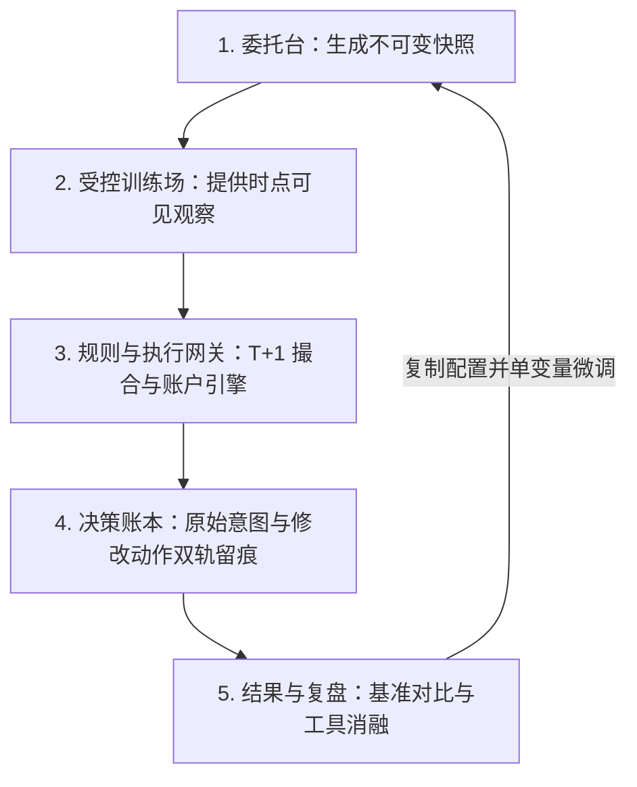
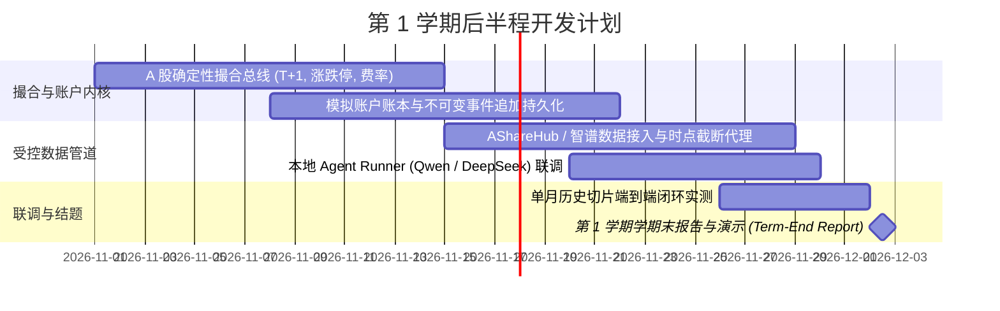

# 毕业设计期中进展报告：openOutcry —— A 股 LLM 交易 Agent 评测与受控训练设施

**课题编号：** QXU2602  
**课题名称：** openOutcry：面向 A 股 LLM 交易 Agent 的评测与受控训练设施  
**学生姓名：** 焦浩南 (JIAO, Haonan)  
**学生学号：** 1155211226  
**指导教师：** 徐强 教授 (Prof. XU, Qiang)  
**所属院系：** 香港中文大学 计算机科学与工程学系 (CUHK CSE)  
**学年学期：** 2026–2027 学年 第一学期 (Term 1，第 1–8 周期中节点)  
**提交日期：** 2026 年 10 月 31 日  

---

## 摘要

本期中进展报告系统总结了毕业设计（Final Year Project, FYP）课题 **openOutcry**（课题编号：QXU2602）在第一学期第 1 至第 8 周期间的各项工作与阶段性成果。openOutcry 旨在为大语言模型（LLM）交易 Agent 建立一套公开、可复现、具备抗污染机制的 A 股评测与受控训练基础设施。

在第 1 学期前半程，我们主要达成了以下关键里程碑：
1. **深入学术与行业调研**：系统论证了金融大模型在历史回测中的“记忆化污染”（Memorization Problem）与“前瞻偏差”（Look-Ahead Bias），确立了包括时点掩码、实体/日期匿名化、样本内外分离、Deflated Sharpe 运气惩罚与最小样本门槛在内的**五大抗污染技术杠杆**；
2. **确立产品闭环与架构体系**：将原本分散的参数配置页升级为**“委托台（Mandate Desk）”**与**“受控训练场（Controlled Arena）”**模型，完成完整的产品需求文档（PRD v0.3）；
3. **完成受控时点检索工具规范**：制定了《受控搜索工具调研与设计规范 v0.2》，通过服务端物理截断（$D-1$ 23:59:59）与无差异空返回机制，彻底切断模型借由工具窥探未来信息的可能；
4. **落地高保真交互原型系统（`openoutcry-web`）**：基于 React 18 + TypeScript 构建了 100dvh 固定视口的 VS Code 级沉浸式三栏工作台，实现了真实 A 股规则（T+1、涨跌停、资金费用）下的账户账本、支持“人工修改参数并双轨留痕”的审批卡（Proposal Ticket）、以及包含工具消融分析的复盘看板。

截至第 8 周，所有既定计划均已按期或超额完成，为后续第 9 至 12 周接入真实行情、部署受控搜索微服务及打通撮合内核奠定了坚实的理论与工程基石。

---

## 1. 课题概况与目标回顾 (Planning 阶段复核)

### 1.1 课题核心目标与定位
**openOutcry** 的核心目标是构建一套**公开、可持续运行的 A 股 LLM 交易 Agent 评测与训练设施**。

用户在平台提交自身的 AI 投资 Agent 配置（包含底座模型、系统提示词、研究工具集以及风控阈值）。平台将 Agent 放入固定受控的历史市场切片中，使其仅基于当时可见的客观证据自主分析、生成决策并下单；平台依据严格的 A 股撮合规则执行订单，并最终交出**不可篡改的成绩单与全量决策证据链**。

**系统明确的边界（非目标）：**
- 不连接真实券商柜台，不执行真实资金下单；
- 不做脱离具体市场规则的通用粗糙回测引擎；
- 不向个人散户提供单向推票或买卖点建议服务。

### 1.2 课题验收三大成功准则
正如 9 月 30 日提交的《FYP Planning Report》中所确立，本项目结题前须满足三项具有区分度的硬性标准：
1. **闭环可演示**：一套 Agent 配置能够跑完一段完整的模拟交易周期，产出精准扣费的净值曲线以及逐笔对应的决策档案；
2. **产出有区分度的行为稳定性结论**：实验证明竞品模型在名义收益率相近时，在行为稳定性（决策翻转率、抗幻觉能力、风控规则遵从度）上存在显著统计差异；
3. **不确定性诚实披露**：样本量不足或交易频次过低时，系统必须明确标注“证据不足”而不予排名，杜绝排行榜噪音。

### 1.3 核心交付物规划 (D1–D6)
全课题规划跨越两个学期，分为六项核心交付物：
- **D1：A 股撮合与账户引擎**：T+1 机制、涨跌停板（$\pm 10\%, \pm 20\%$、ST 限制）、整手交易（100 股）、除权除息调整与交易规费/印花税的真实结算；
- **D2：抗污染数据层**：所有数据出口强制执行时点掩码，支持实体与日期匿名化，配备事后数据泄漏审计扫描器；
- **D3：决策账本与轨迹留痕**：全量持久化 Agent 思考链、工具调用参数、证据编号引用、原始订单意图与人工介入动作；
- **D4：多维指标集与体检报告**：区分样本内与样本外窗口，引入 Deflated Sharpe Ratio (DSR)，统计决策翻转与胜率；
- **D5：多 Agent 协同与工具消融**：支持多角色 Agent 流水线分工（交易、研究、风控），支持针对行情、公告、新闻工具的消融对比实验；
- **D6：完整交互系统与开源代码仓**：端到端 Web 工作台、标准化 Agent 接入协议、可复算的测试集与重放文件。

---

## 2. 第 1 至第 8 周完成的工作与阶段成果

第 1 至第 8 周（2026 年 9 月至 10 月底）的工作主要围绕四个交织的主线推进：竞品剖析与定位、抗污染机制形式化、产品架构文档定稿、以及高保真 Web 原型工程落地。


### 2.1 痛点形式化：记忆化问题与五大抗污染技术杠杆
在第 5 至第 6 周，我们对当前 LLM 投资回测为何普遍“失真”进行了深入的理论与文献实证梳理：

#### 学术文献证据
- **记忆化问题 (*The Memorization Problem*, arXiv:2504.14765, 2025)**：主流底座大模型在预训练时吞噬了大量公开金融数据（如 BloombergGPT 涵盖 3630 亿 token，同花顺问财与东财妙想各涵盖超万亿 token）。当在已见过的历史时段进行“推演”时，模型很大程度上是在检索记忆中的行情走势，而非进行因果经济推理，导致回测中的高夏普率无法泛化到真实未知市场。
- **前瞻偏差基准 (*Look-Ahead-Bench*, arXiv:2601.13770, 2026)**：证实即使提示词严厉禁止模型使用未来信息，只要历史日期与公司真名可见，模型仍会无意识引用事后财报数值，证明“仅靠提示词约束绝对无法消除时间泄露”。

#### 提炼五大抗污染技术杠杆
为了将主观回测改造为客观科学的评测基准，我们明确了平台底层必须具备的五大控制变量：
1. **时点硬掩码 (`point_in_time_masking`)**：当模拟时钟处于交易日 $D$ 时，新闻、公告与财务数据在底层数据管道全部硬截断至 $D-1$ 23:59:59（北京时间），未来数据在物理上绝不进入上下文。
2. **日期与公司实体匿名化 (`anonymize_dates`, `anonymize_entities`)**：在严格评测模式下，绝对日期转换为相对交易日偏移量（$T_0, T_1, \dots$）；公司代码与全称替换为板块内可逆伪名（如 `公司-A089`），同时保留 688、300 等板块交易特征，切断模型的精确记忆检索。
3. **样本内外时间分离 (`eval_window`)**：登记各参评模型的知识截止时间（Cutoff），官方榜单强制在 Cutoff 之后的时间窗口进行盲测，并引入 Purged CV（清除与封禁期），消除重叠收益。
4. **Deflated Sharpe Ratio (`ranking_metric = dsr`)**：针对“多次调试参数挑出最优回测”的数据偷窥偏差，引入 DSR 指标，根据尝试次数与收益偏度对名义夏普值进行折扣惩罚。
5. **最小样本量门槛 (`ranking_min_samples`)**：规定至少覆盖 20 个交易日与 15 笔闭环交易才计入正式评测榜单，样本不足者一律标明“证据不足，不予排名”。

---

### 2.2 产品业务定义与系统架构 (PRD v0.3)
在第 6 至第 7 周，我们完成了 openOutcry MVP 的核心产品需求文档（PRD v0.3），确立了系统的运行闭环生命周期：



#### 委托单数据模型 (Mandate Model)
一次标准的训练不再是松散的会话，而被严格定义为一个不可变四元组快照：
$$\text{Mandate} = \langle T_{\text{window}}, U_{\text{universe}}, \text{Team}_{\text{agents}}, R_{\text{rules}} \rangle$$
- **时间窗口 ($T_{\text{window}}$)**：起始与结束日期。锁定后模拟时钟按交易日离散推进，严禁模型自行跳跃时间；
- **标的池 ($U_{\text{universe}}$)**：选定的股票池（如沪深 300 成分股精选、行业指数篮子）；
- **团队分配 ($	ext{Team}_{\text{agents}}$)**：支持将多个 Agent 或模型编组为流水线分工：
  - *研究 Agent*：检索新闻公告、提炼多空基本面；
  - *交易 Agent*：计算目标仓位、买卖方向与限价；
  - *风控 Agent*：对组合集中度、回撤与现金余额进行最后合规核验。
- **规则配置 ($R_{\text{rules}}$)**：初始资金规模、执行模式（逐案审批 vs 自主运行）以及费率表。

---

### 2.3 受控历史搜索工具设计规范 (v0.2)
在《受控搜索工具调研与设计规范 v0.2》中，我们详细制定了对外交互的接口规范：
- **统一 `historical_search` 接口**：彻底剥离通用互联网浏览器，Agent 仅允许访问受控沙盒检索端点；
- **结构化输出**：返回统一的结构化凭据 `{ evidence_id, title, published_at, snippet, full_text_ref }`；
- **防信息泄漏的无差异空返回**：若 Agent 查询了截断时点之后的新闻、或者输入了不存在的股票代码，系统统一返回空集合（`{ hits: [] }`），绝对不返回诸如*“该新闻存在但晚于截止时间被过滤”*的错误提示，杜绝模型借此反推未来波动。

---

### 2.4 高保真交互原型实现 (`openoutcry-web`)
在第 7 至第 8 周，我们基于 React 18、Vite、TypeScript 与 Tailwind CSS 完整实现了前端交互原型系统：

```
openoutcry-web/src/
├── routes/
│   ├── StudioPage.tsx       # 01 新建训练 (委托台与运行卡)
│   ├── TrainingPage.tsx     # 02 训练场 (100dvh 三栏专业工作台)
│   ├── ReviewPage.tsx       # 03 结果与复盘 (净值、回撤、消融分析)
│   ├── ConnectPage.tsx      # 04 连接 Agent (能力发现与接入沙盒边界)
│   ├── ProtocolPage.tsx     # 05 协议与 Skill (Message/Event/Action 模式分离)
│   └── GuidePage.tsx        # 06 产品说明 (为什么不是对话框、为什么需要审批)
├── components/
│   ├── chrome/              # Masthead, Tape, SideNav (自适应 64px/224px)
│   ├── studio/              # MandateTicket, TrainingLedger
│   ├── training/            # ConversationPane, WorkbenchPane, TaskSwitcher
│   └── run/                 # StatBand, AccountLedger, HoldingsList, ProposalTicket
└── store/                   # RunProvider, Mock 数据源, 事件轨迹持久化
```

#### 核心实现亮点：
1. **01 新建训练 (`/studio`)**：四格委托单组件（MandateTicket），右上角集成深色仪器风格的“当前运行卡”，下方配有历史训练账本并支持一键克隆配置；
2. **02 训练场 (`/training`)**：打造了 **VS Code 式的 100dvh 固定视口三栏工作台**：
   - *左栏（会话与思考链）*：Agent 独白平铺展开，工具调用与证据引用折叠展示，带有编号与时间戳；
   - *中栏（交易工作台）*：顶部是实时的净值/现金/持仓走带；中间是核心的**审批修改票（Proposal Ticket）**，人类在此拥有“直接批准、修改买卖参数、拒绝驳回”三大权力；下方展示严格执行 T+1 可用份额计算的持仓表；
   - *右栏（任务切换器）*：支持在多段子任务或不同 Agent 团队之间瞬时横跳切换；
3. **03 结果与复盘 (`/review`)**：对比沪深 300 基准超额收益曲线、最大回撤曲线以及**工具调用消融图**；
4. **04 & 05 连接与协议 (`/connect`, `/protocol`)**：在代码层形式化隔离了**会话消息（Message）**、**平台事件（Event）**与**交易动作（Action）**，为未来对接外部 Python Runner 或远程 API 奠定了协议接口。

---

## 3. 计划进度与实际进展对比 (Milestone Evaluation)

下表将《FYP Planning Report》制订的甘特进度与截至第 8 周的实际交付成果进行逐项对照：

| 阶段划分 | Planning Report 原定计划工作 | 期中实际交付成果 (截至第 8 周) | 进度与偏差评估 |
| :--- | :--- | :--- | :--- |
| **第 1–4 周**<br>*(9月)* | • 竞品剖析与赛道定位<br>• 确定核心功能与排期<br>• 提交开题规划报告 (Planning Report, 9.30) | **已完成**<br>• 完成 BloombergGPT、问财、TraderHarness、TradeRank 等调研<br>• 确立三大验收标准<br>• 提交 Planning Report | 按期达成。 |
| **第 5–6 周**<br>*(10月上中旬)* | • 竞品调研收尾与差异化确立<br>• 调研历史回测中的前瞻偏差与记忆问题<br>• 设计抗污染机制方案 | **已完成**<br>• 完成 *The Memorization Problem* 与 *Look-Ahead-Bench* 论文精读<br>• 确立五大抗污染技术杠杆<br>• 完成《受控搜索工具调研与设计规范 v0.2》 | 按期达成，且理论形式化深度超过最初设想。 |
| **第 7–8 周**<br>*(10月下旬)* | • 定稿功能模块与产品设计<br>• 输出功能文档与设计草案<br>• **提交期中进展报告 (Mid-Term Report, 10.31)** | **超额并提前完成**<br>• 完成 PRD v0.3 规范文档<br>• **不仅停留在线框图，而是提前完整实现了交互原型系统 `openoutcry-web`**<br>• 提交期中进展报告 | **超出预期进度**。跳过了纯线框图阶段，直接落地了高保真可运行的前端代码，提前暴露并解决了人机交互与状态管理问题。 |
| **第 9–12 周**<br>*(11月至12月初)* | • 数据源与撮合引擎技术调研<br>• 开始后端核心模块开发<br>• 提交学期末进展报告 (12.2) | *进入下一阶段执行* | 前端状态模型与协议接口已完全就绪，可直接对接后端数据与撮合内核。 |

---

## 4. 关键发现、工程挑战与系统架构演进

在从抽象文档走向真实 Web 原型开发的过程中，我们获得了三点深具价值的架构认知演进：

### 4.1 从“单一 Agent 参数配置表单”演进为“委托台 (Mandate Desk)”
- *原有设想*：最初认为只需要一个类似表单的页面，输入模型名称、填入提示词即可启动测试。
- *实际发现*：金融评估绝不可能脱离特定市场环境而存在，脱离了标的流动性与时间区间的 Agent 评估毫无意义；同时复杂的量化投资往往需要交易、研究与风控的分工协作。
- *架构演化*：将其重构为**委托单（Mandate Ticket）**，以“时段 × 标的池 × 团队协作 × 规则”四元组为一次实验的原子单元，支持给多个 Agent 分配专业角色。

### 4.2 从“普通对话气泡”演进为“VS Code 式三栏高密度工作台”
- *原有设想*：采用类似 ChatGPT 的垂直瀑布流气泡对话。
- *实际发现*：对话框极度助长模型叙述性幻觉，却隐藏了量化交易的生命线——资金仓位与合规状态。专业研究员在观察 Agent 时，必须同屏看到“引用了什么证据”、“下了什么单”以及“账户现金和可用股数如何变化”。
- *架构演化*：设计了 100dvh 固定视口的三栏联动工作台，左栏查思维链与证据、中栏批订单与看账本、右栏切任务，消除跨页面频繁跳转的信息损耗。

### 4.3 确立“人机协同修改动作的双轨留痕机制”
- *原有设想*：人机交互只提供简单的“同意 / 拒绝”两个选项。
- *实际发现*：在真实投资介入中，专业交易员极常发现 Agent 方向看对但仓位算错（例如将 5,000 股下调至 2,000 股）。若系统仅记录最终成交订单，就会在后续统计中错误地将人类风控的功劳全部算给 AI。
- *架构演化*：我们在审批单中开辟了**参数修改功能**，并在底层数据结构中严格同时记录 **Agent 原始意图（Raw Proposal）** 与 **人类修改动作（Modified Action）**。在最终复盘中严格划分自主与混合收益，确保学术评测的绝对真实性。

---

## 5. 第 1 学期后半程 (第 9–12 周) 及下学期计划安排

伴随着原型系统的就绪，第 9 至第 12 周的工作重心将全面转入**后端撮合内核与真实数据管道的开发与联调**：



### 5.1 第 9–12 周具体任务拆解：
- **第 9–10 周（11月1日–11月14日）：A 股撮合与账户引擎开发 (交付物 D1)**
  - 实现本地撮合总线（`TradingBus.place_order()`）；
  - 编码实现 A 股硬性规则：T+1 资金与持仓可用锁定、$\pm 10\%, \pm 20\%$ 涨跌停拒绝、100 股整数手、印花税（卖出万分之五）、过户费与佣金精确扣除。
- **第 10–11 周（11月8日–11月21日）：受控数据源接入与时点代理部署 (交付物 D2)**
  - 接入 AShareHub 历史日频行情与财经资讯接口，补充智谱 Web Search API；
  - 部署 Point-in-Time 物理过滤代理，验证 $D-1$ 23:59:59 之后的数据绝对不可被 Agent 检索。
- **第 11–12 周（11月15日–11月28日）：Agent Runner 协议与端到端跑通 (交付物 D3, D6)**
  - 开发轻量级本地 Agent 执行器（Runner），通过标准 Tool-Calling 协议与平台通信；
  - 挂载本地开源模型（如 Qwen-2.5-7B 或 DeepSeek-V2.5），在 2024 年 4 月份历史数据上跑通完整的真实闭环实验；
  - 验证：委托创建 $\rightarrow$ 受控搜索 $\rightarrow$ 提案生成 $\rightarrow$ 撮合记账 $\rightarrow$ 导出全量决策证据链。
- **第 12 周（11月底–12月2日）：学期末总结与演示汇报准备**
  - 对生成的决策轨迹进行数据泄漏扫描审计；
  - 汇总输出《Term 1 Term-End Progress Report》（预计 12 月 2 日提交），并向导师进行阶段性系统联调演示。

---

## 6. 期中交付物汇总清单

截至 2026 年 10 月 31 日，本项目在代码仓库中已完成归档的核心交付物包括：

1. **FYP 开题报告 (Planning Report)**：归档于 `exports/FYP-Planning-Report.docx` 与 `hitstory-doc/`；
2. **产品功能需求文档 (PRD v0.3)**：`research/openOutcry-产品设计与功能-MVP.mdx`（配套离线可渲染 SVG 预览文件 `hitstory-doc/preview.html`）；
3. **受控搜索工具设计规范 (v0.2)**：`research/openOutcry-受控搜索工具调研与设计-v0.2.md`；
4. **高保真可交互 Web 原型系统**：完整工程代码见 `openoutcry-web/`（覆盖 6 大核心路由，自适应响应式布局与完备的状态模型）；
5. **导师汇报演讲稿与答辩演练预案**：`hitstory-doc/导师周报与演播稿-openOutcry.md`；
6. **线上飞书知识空间**：同步维护于 `https://bcnd63yb3pzy.feishu.cn/wiki/SYwXw5XH2iKfK5kXnqnc6nvknlf`。

---

## 参考文献

1. **HephaestLab.** (2026). *TraderHarness: Contamination-Resistant Backtesting Environment and Synthetic Data Generator for LLM Trading Agents.* GitHub 仓库: https://github.com/HephaestLab/TraderHarness.
2. **Li, Y., et al.** (2025). *The Memorization Problem: Can We Trust LLM Forecasts on Historical Financial Data?* arXiv 预印本 arXiv:2504.14765.
3. **Zhang, X., et al.** (2026). *Look-Ahead-Bench: A Diagnostic Benchmark for Forward-Looking Bias and Information Leakage in Financial LLMs.* arXiv 预印本 arXiv:2601.13770.
4. **香港大学 FinAI 实验室.** (2025). *AI-Trader: An Autonomous Multi-Agent Trading System and Evaluation on Chinese Equities.* arXiv 预印本 arXiv:2512.10971.
5. **TradeRank 联盟.** (2025). *TradeRank: A Benchmark for LLM Agent Financial Trading Across Diverse Market Regimes.* https://www.traderank.ai/llm-trading-benchmark.
6. **Wu, S., et al.** (2023). *BloombergGPT: A Large Language Model for Finance.* arXiv 预印本 arXiv:2303.17564.
7. **Bailey, D. H., & López de Prado, M.** (2014). *The Deflated Sharpe Ratio: Correcting for Selection Bias, Backtest Overfitting, and Non-Normality.* Journal of Portfolio Management, 40(5), 94–107.
