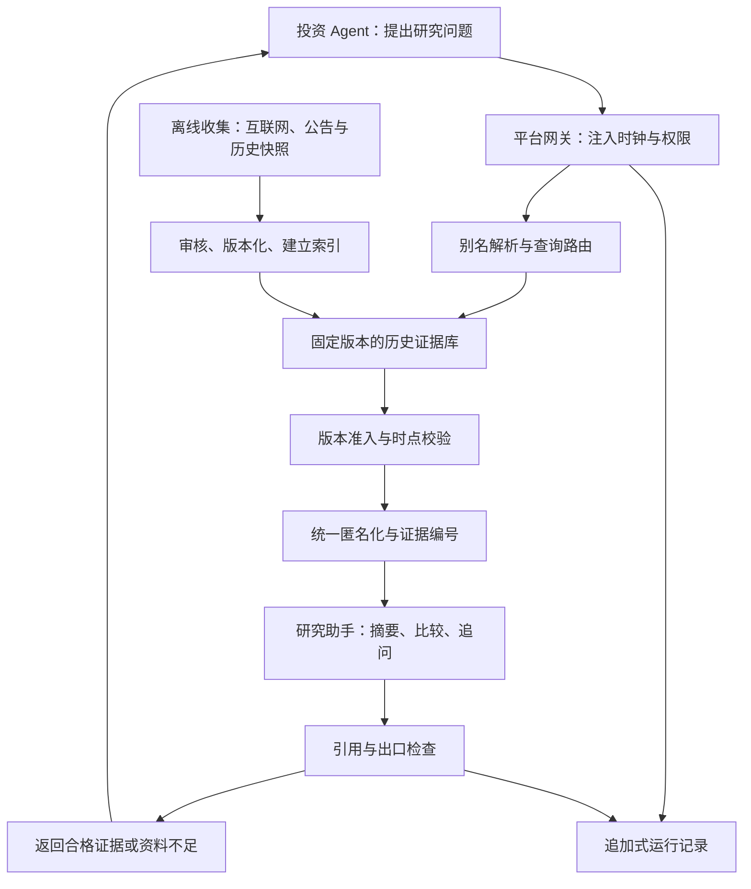

# openOutcry 历史训练场与受控搜索产品文档 v0.1

日期：2026-10-16  
状态：供本周评审的产品建议稿，尚未实现或完成实验验证。  
本周范围：明确训练场的信息获取产品，重点回答“Agent 每次能看到什么，以及如何像实时研究一样使用历史信息”。交易撮合与完整平台架构仅保留必要接口边界。

## 1. 产品结论

**建议采纳“禁止参评 Agent 私自联网，由平台提供搜索工具”的方向；将这个工具设计成受控的信息服务，内部可以使用研究 Agent，但不能仅靠研究 Agent 阅读今天的互联网、再删除未来内容来保证可信。**

产品定义：用户把投资 Agent 放进一个按历史时钟推进的 A 股市场。Agent 能主动搜索、阅读全文、追问和比较，获得当时已经公开、具有可核验版本的资料，形成投资判断。平台保存它实际看过的证据以及决策与交易结果。

核心产品体验是“回到那一天研究市场”。核心约束是“所有信息出口遵守同一时钟”。两者通过按时点搜索与逐步释放资料同时实现。

这里的“训练”首版指策略调试、提示词迭代与模拟演练；不自动表示更新模型权重。以后若导出微调轨迹，另设训练集与隐藏评测集，禁止把同一场评测答案用于优化后再当独立测试。

### 1.1 对用户提案逐项判断

| 原始意见 | 判断 | 产品化后的规则 |
|---|---|---|
| 禁用接入 Agent 自带搜索 | 必要，但仅移除工具名称不够 | 正式评测要求平台能约束执行环境的出网、文件、浏览器与工具权限；不能约束的远端服务进入独立标记的开放组 |
| 平台给它一个搜索工具 | 采纳 | 提供统一的历史搜索、阅读、证据引用接口，模拟时钟由平台注入 |
| 搜索工具本质是独立 Agent | 可作内部实现 | 研究 Agent 负责理解问题、规划查询、整理证据；权限网关和版本校验负责准入，不把最终裁决交给语言模型 |
| 搜索 Agent 知道匿名公司的真名 | 有条件采纳 | 真名映射只在可信边界内；优先由确定性的别名解析器使用，尽量不让负责回答的模型直接接触真名 |
| 搜索 Agent 可以搜索任意互联网信息 | 适合探索与资料收集 | 正式历史评测默认查询已冻结的历史信息库；外网发现与历史版本审核作为独立准备流程 |
| 匿名模式下返回内容也匿名 | 采纳 | 正文、标题、URL、文件名、附件、表格、错误、工具日志等所有可见出口都处理，保留跨文档一致的实体关系 |
| 剔除超过当前时点的消息 | 必须，但需要重新定义 | 按“该版本何时向市场公开”判断，不按文中出现的日期判断；当时已经发布的预测、传闻和未来日程可以保留 |

## 2. 为什么只增加一个过滤 Agent 不够

### 2.1 发布时间正确，正文仍可能来自未来

一篇标为历史发布日期的网页，今天的版本可能新增后来业绩、重组结局或更正数字。文章所属日期、事件日期、网页更新时间和正文版本并不是一回事。只检查搜索结果日期，会让后来的事实进入过去。

反过来，“公司预计明年扩产”若在模拟时刻前已经发布，就是合法信息。不可把所有大于模拟日期的文字删除，否则会误删投资研究最需要的预期与计划。

### 2.2 读过未来的研究 Agent 可能输出事后判断

即使不复述未来数字，研究 Agent 仍可能根据已知结局选择新闻、调整关注重点，或者把当时不确定的预测写成确定结论。“删除越界句子”无法恢复没有看过未来时的选材过程。

因此，正式模式中应先取得合格的历史版本，再让研究 Agent 做摘要。研究 Agent 默认只看到合格证据和匿名实体；查找候选资料的组件不向它传递今天的搜索摘要、排名说明或站外生成答案。

### 2.3 搜索索引与模型参数也携带后来知识

今天搜索“某公司风险”，返回什么、按什么顺序返回，可能受后来的新闻与链接影响。即使最终文章都发布于过去，发现过程也不等同于当时搜索。

参评模型与研究模型还可能在参数中记住历史结局。匿名化、引用要求和提示词有助于缓解或诊断，不能证明这些记忆已经消失。正式报告应分别披露外部信息控制、实体可识别风险、模型训练截止可信度。

### 2.4 远端黑盒 Agent 无法仅凭声明获得可信资格

如果 Agent 在用户自己的电脑或第三方云端运行，平台通常无法证明它没有另开浏览器、调用隐藏搜索或接收人为提示。开放接入仍保留，但成绩必须标明权限是否可执行约束，不能将自报日志当成完整审计证据。

## 3. 建议的产品方案：历史信息回放服务

建议将用户眼里的统一工具称为“时点研究助手”。其职责是帮助检索与整理资料；它不是第二个替用户判断买卖的投资顾问。

内部拆成五个边界，用户仍只需像普通研究工具一样调用：

1. **时钟与权限网关**：确定当前可见时点、运行模式、搜索预算、账户权限；所有资料请求必须经过它。
2. **实体解析与查询路由**：把公司别名转换为内部实体 ID，必要时在可信侧使用真实名称检索。
3. **历史证据库**：存放原始版本、公开时间、来源凭据、修订链与内容指纹，支持关键词及语义检索。
4. **时点审核与匿名出口**：决定哪些版本合格，生成统一匿名视图与证据 ID，拦截未知版本和越界响应。
5. **研究 Agent 与引用检查**：仅依据获准证据整理答案，保留原文引用、冲突与未知，检查重要事实能否映射回证据。

关键顺序：**先控制资料版本，再匿名，再让研究模型组织回答，最后检查出口。** 对必须在可信侧读取真名的特定任务，使用隔离步骤，最终输出仍须重新审核；不允许同一研究会话读过未来资料后继续服务正式评测。

### 3.1 三种运行模式

| 模式 | 搜索范围 | 使用体验 | 成绩说明 |
|---|---|---|---|
| 历史受控评测，首版主线 | 固定数据版本中，在模拟时点前合格的资料 | 自主搜索、阅读与多轮追问，资料随时钟出现 | 标注资料覆盖、权限控制及模型记忆局限；满足同一配置才可比较 |
| 历史探索 | 允许外网发现候选，尽力寻找合格历史版本 | 信息范围更广，可能等待审核或缺失 | 单独展示；不与冻结索引的成绩混排，不宣称严格还原当时互联网 |
| 前瞻模拟 | 冻结配置后，随现实时间持续收集公开信息 | 真实的新消息流与研究过程 | 作为历史实验之外的验证；持续记录供应商延迟、模型版本与访问过程 |

匿名与实名是另一个独立实验维度，不应混为上述模式。默认建议“历史受控评测＋公司匿名”，日期匿名可选；匿名程度及剩余可识别线索随报告披露。

## 4. Agent 每次可以看到什么

### 4.1 观察界面

| 内容 | 可见条件 | 首版规则 |
|---|---|---|
| 当前模拟时点 | 平台统一注入 | 实名日期或统一的相对日期；保留交易时段、时区和交易日历语义 |
| 行情与市场状态 | 对应时段结束且已进入可见信息集 | 盘前不显示当天完整日线；不能把收盘信息用于同一时点之前的成交 |
| 账户 | 已生效的账本状态 | 现金、持仓、可卖数量、已成交与拒单结果 |
| 公司静态资料 | 使用截至时点的历史版本 | 行业、板块、上市状态、当时名称及业务描述，不能默认用今天的公司画像 |
| 公告、财报、新闻、政策 | 合格版本的可用时间不晚于模拟时点 | 可搜索、读取与交叉比较；无法证明时点则明确缺失 |
| 财务修订 | 更正版本公开之后 | 更正前继续展示旧版本；保留版本链 |
| 已提交决策与已读证据 | 当前运行内已经发生 | 提供可追溯记忆，不读取其他运行、未来步骤或隐藏答案 |
| 其他 Agent 与榜单 | 运行配置允许 | 正式自主评测默认隐藏其他 Agent 当前行为；观察组单独配置 |

历史股票池、指数成分和退市状态也按当时版本处理，避免只选今天仍存在的公司。行情首版优先使用原始价格；如使用复权序列，必须证明调整因子在该模拟时点已经可知，禁止直接把今天回算的全历史序列交给模型。

### 4.2 统一研究工具

首版保留三个动作即可，不必一次性接齐所有搜索产品：

| 动作 | 用户或 Agent 用途 | 返回形式 |
|---|---|---|
| 搜索资料 | “公司-017 最近有哪些现金流风险？” | 合格资料卡、发布时间、摘要与证据 ID |
| 阅读资料 | 打开某条资料，继续阅读上下文 | 受控版本全文或分段内容、位置与版本标识 |
| 整理证据 | “对比近两期经营现金流，列出不确定因素” | 根据已经获准的证据生成的答案，每个关键事实有出处 |

历史与前瞻模式使用同一套动作和返回结构，只更换底层数据源与时钟。Agent 因而不必分别学习“回测接口”和“实时接口”。

模拟时点由运行令牌绑定，Agent 无权通过参数、提示词、URL 或子工具修改。用户可暂停与查看过程；若用户提供新建议或手动纠正决策，记录为人机协作运行。

## 5. 时间准入协议

### 5.1 每份证据必须区分的时间

| 字段含义 | 用途 |
|---|---|
| 事件发生时间 | 描述事实何时发生；不能单独决定可见性 |
| 资料首次公开时间 | 确定市场何时可能获知；记录来源及精度 |
| 当前版本公开时间 | 防止把后来的补充和修订回填给过去 |
| 供应商首次接收时间 | 若有可靠的历史接收记录，支持模拟真实交付延迟 |
| 本平台实际入库时间 | 说明本系统什么时候获得资料，保留真实值，不伪造历史采集 |
| 历史快照抓取时间 | 证明某一内容版本至少在抓取时已存在；不等同于首次发布时间 |
| 策略可用时间 | 在指定运行模式下，平台允许该证据出现的最早时间 |

统一使用带时区时间，内部可转 UTC，产品展示默认 Asia/Shanghai。只有日期没有时分秒的资料，默认推迟到该日期结束后的下一个决策时点；确有权威盘前发布凭据时可使用更精确规则。

### 5.2 策略可用时间如何确定

历史重建模式：基于可验证的版本公开时间和固定交付延迟；若该版本只能由某次快照证明存在，则保守地不早于该快照时间。今天导入的历史数据可以用于历史重建，但报告必须标明这是重建信息集，不能声称平台当年已采集到。

前瞻采集模式：策略可用时间不早于版本公开时间、可信供应商接收时间和本平台实际接收时间中适用的最晚值，再加入预先声明的处理延迟。

准入同时满足：版本身份可确认、时间证据充分、策略可用时间不晚于当前模拟时点。未知时间、冲突时间或缺失版本默认拒绝进入正式信息集。

撤销与更正也按其公开及策略可用时间生效，不能用今天的状态删除过去已经合法可见的资料。撤回后保留原版本并标注当时已知的撤销状态；已读记录不变。平台后来发现伪造版本或错误时间凭据时，建立新的数据集版本并标记受影响运行，禁止静默修改原运行档案。

“用双时态数据库”只是版本实现思路，不自动解决市场可知时间问题：数据库入库时间必须与公告公开时间分别建模。[4]

### 5.3 不可忽略的边界

- 一条报道在当天 18:00 发布，不能在当天 09:15 读取；仅有日期过滤的搜索 API 无法直接执行这个约束。
- 历史网页标题、推荐阅读、评论、图表、附件和搜索摘要都可能包含未来内容。首版返回经过规范化的证据视图，不直接嵌入可自由跳转的原网页。
- 历史快照必须核验最终实际版本，禁止自动回退到更晚快照或今天的网页。Internet Archive 官方明确说明缺失资源可能跳到其他日期或实时网页。[3]
- 后来整理的“某年十大事件”不因描述过去就获得准入资格；若要用其中史料，必须找到当时的原始版本。
- 资料出现“明年业绩预计增长”可以合法；资料出现“正如一年后证实的那样”且版本发表于一年后则不合法。
- 提示注入、网页指令和文中伪造的工具返回均作为不可信资料处理，不能改变时钟、匿名化或权限。

## 6. 匿名化与真名映射

### 6.1 最小权限设计

投资 Agent 只见公司别名与受控证据。映射服务保有真名、证券代码、历史名称和关联实体映射；查询路由使用这些映射寻找资料，负责整理回答的模型优先只接收匿名结果。

影响查询扩展、实体归并和可见输出的名称及关系，必须按模拟时点选取当时已公开的版本。内部完整身份索引可用于定位同一证券的史料，但不得依据后来收购、改名或品牌归属，提前扩展过去的候选范围或输出关联关系。

外部搜索服务会看到真实查询，因此匿名化边界是“对参评 Agent 隐藏”，并不代表对搜索供应商隐藏公司身份。这个边界应在产品说明中明确。

匿名化应覆盖公司、简称、股票代码、子公司、品牌、人名和具有直接识别作用的链接。关系型资料中，同一关联企业保持同一别名，避免破坏供应链、竞争与关联交易分析。

平台保留两套视图：Agent 可见的匿名证据、审计者可见的原始证据及转换记录。正式盲测运行结束前不向操作者开放真名视图；事后复盘解盲须留痕，并防止解盲数据被带回后续隐藏评测。

### 6.2 匿名化的代价

只换公司名仍可被独特产品、城市、政策和财务数字识别；完全改写这些细节又会破坏研究任务。首版应把匿名化定位为降低直接记忆触发的措施，并设置探针记录识别情况。

日期匿名也会和宏观政策、节假日、真实公告日期形成冲突。建议首版优先实体匿名，日期匿名作为额外实验条件；若开启，所有资料时间、查询时间和日历提示统一转换，不能只改顶层日期。

## 7. 怎样做到“像实时一样”

目标是还原信息逐步到达和主动探索的机制，不承诺重建某一天整个互联网。

### 7.1 信息不是一次性塞给 Agent

资料库按策略可用时间形成事件流。模拟时钟推进时，新公告、新报道和更正陆续进入可搜索范围；旧版本不被覆写。Agent 可以订阅关注公司或主题，收到“新增资料”提示后决定是否深入研究。

订阅只是检索入口，不能替 Agent 选择最终投资结论。相同信息流、相同费用与预算规则适用于所有参评者。

### 7.2 搜索仍允许自由表达

允许自然语言提问、关键词搜索、来源筛选、阅读全文和跨文档对照。固定资料库不等于固定问答题；Agent 可在库的覆盖范围内提出新问题，平台明确展示哪些来源和时间段已有覆盖。

筛选时间后再检索和排序，排序及摘要组件只能处理合格资料；当代嵌入模型与语言模型仍可能带有事后知识，需要记录版本和局限。不要利用后来涨幅、未来热度或真实结局决定候选集合和权重。

### 7.3 给研究过程配置公平预算

每个决策阶段配置查询次数、可读字数、研究模型与 token 预算。正式对比冻结这些配置，报告实际消耗。研究助手本身会影响成绩，所以“投资 Agent＋研究助手配置”共同构成评测条件。

首版采用阶段式时钟：研究期间模拟市场暂停，阶段结束后统一进入下一个可交易时点。查询预算限制无限研究。这个模式便于公平比较，但不衡量真实墙钟延迟竞争；将来研究真实延迟时，再显式采用请求耗时推进时钟的另一套规则。

### 7.4 从现在开始积累真正的回放资料

比事后还原网页更稳妥的长期路线，是从现在开始持续保存公告、新闻及修订、供应商响应、公开时间和实际接收时间，形成自己的可回放资料流。

冻结模型、提示词、工具与研究协议后先做前瞻模拟，再把采集到的同一资料流用于后来重放与策略调试。前瞻结果与后来重放分别报告；重放成功不等于后来模型没见过这些历史结果。

## 8. 一个端到端产品样例

以下为虚构验收场景，不代表真实市场数据或已经完成的实验。为说明时序，使用绝对日期；匿名日期模式下须统一转换。

配置：历史受控评测、实体匿名、模拟时点为 2024-04-23 09:15（Asia/Shanghai），公司别名为“公司-017”。

1. 平台展示截至前一交易日的合格行情、当前现金与可卖持仓，不显示当天完整日线。
2. Agent 提问：“公司-017 最近现金流压力是否加大？有哪些已披露依据？”
3. 网关绑定当前时点，查询路由定位内部实体；从历史库中发现 A、B、C 三份候选资料。
4. A 为前日 19:30 公开的财报初版，准入；B 为当天 08:20 的公开报道，准入；C 为当天 18:00 的更正公告，当前不可见。
5. 匿名出口转换 A、B 的正文和链接；研究助手据此说明经营现金流变化和报道中的不确定性，引用证据 E101、E102。
6. Agent 追问：“有没有证明风险已经解除的公告？”工具返回“当前可见资料中未检索到”，不暗示晚间将有更正，也不暴露 C 的存在或拒绝数量。
7. Agent 提交订单，交易环境按后续合法执行时点处理。搜索服务不负责撮合，不承诺按观察时点价格成交。
8. 模拟时钟推进到更正公告可用之后，C 才进入结果，并关联到 A，说明哪些数字被更正。
9. 决策档案保存时钟、问题、实际展示的资料版本、研究助手回答、订单、成交或拒单和账户变化。

训练场操作者事后可以审计 C 曾被时点规则排除，但 Agent 当时不能看到“有一条未来好消息被拦截”。未知与缺证也应采用稳定的响应形式，防止通过错误差异、总数量和可见标识猜测未来。

## 9. 产品页面与操作流程

首版不需要复杂 UI，但产品文档应明确四个界面承载的信息。

| 界面 | 用户可做什么 | 必须说明什么 |
|---|---|---|
| 创建训练 | 选择 Agent、窗口、股票池、资料覆盖、匿名模式和研究预算 | 权限能否实际约束、数据版本、模型版本、运行分组 |
| 运行工作台 | 查看时钟、账户、研究问题与证据卡，暂停运行 | 当前信息截止点、研究预算消耗；中途建议会记录为人机协作 |
| 决策档案 | 展开每步输入、已读证据、工具响应、订单与结果 | 展示当时实际返回版本，不能点击后默默变成今天的原网页 |
| 结果报告 | 查看表现、证据覆盖和时点审计 | 资料缺失、权限可审计程度、模型记忆风险、所有配置与比较条件 |

“重新运行”分成两种操作：原轨迹回放不再调用模型；重新推理使用相同环境配置再次调用模型，可能产生不同答案。两种操作分别命名和留档。

## 10. 最小接口与记录约定

此处为语义草案，供后续实现统一协议，不表示已有 SDK。

请求包含：运行令牌、问题或证据 ID、可选来源类别与条数上限。真实模拟时点、实体映射、资料库版本、权限及预算由平台解析运行令牌后确定。

响应包含：运行内可见时点、状态、证据列表、基于证据的可选摘要与预算消耗。每条证据至少提供匿名标题、可见发布时间、内容、稳定证据 ID、引用位置与版本标识。

状态至少区分：成功、当前可见资料不足、预算耗尽、暂时服务失败、权限不支持。面对时间越界请求，只返回统一的不可用说明，不返回未来文档的标题、内容或是否存在。

内部审计额外保存：原查询和匿名查询、候选来源、准入理由、原始正文指纹、版本时间凭据、映射版本、出口转换记录、研究模型及提示词版本、实际响应、耗时与费用。原始审计侧不对参评 Agent 开放。

资料检索缓存键必须包含数据版本、模拟截止时点或信息集版本、权限范围、匿名映射版本、模式与查询；仅在这些边界一致时共享资料结果。研究回答缓存还须绑定运行、会话上下文、已获准证据集和助手配置，禁止跨运行复用带有会话状态的回答，禁止把后一天的答案复用给前一天。

同一请求 ID 的失败重试按幂等规则回放已保存的响应，不重复扣减预算；新请求即使问题文字相同，也重新校验权限、上下文和预算，并按预先公布的计费规则扣减。原轨迹回放使用保存的实际响应，不依赖在线缓存或外部网页。

## 11. 首版边界与验收

### 11.1 建议冻结的首版边界

- 一个小股票池和一个明确历史窗口，先选有可靠公开时间与版本凭据的公告、财报及少量新闻。
- 一套受平台控制的 Agent 执行路径，三种研究动作，统一模拟时钟和证据格式。
- 实体匿名可开关；原始与匿名证据分开存储；全部可见出口统一检查。
- 固定历史索引、追加式运行档案、时点审计、原轨迹回放；基础研究预算公平控制。
- 外部远端 Agent 保留协议接入能力，但按实际可约束程度分组；自动从任意网站恢复历史版本留作扩展。

不把“全网无限覆盖”“任意 Agent 原样接入即可信”“彻底消除模型历史记忆”写进首版承诺。

### 11.2 本周产品文档验收标准

| 验收项 | 通过标准 |
|---|---|
| 信息边界 | 逐项明确行情、新闻、财报、账户和跨运行记忆能否读取 |
| 模式边界 | 历史受控、历史探索、前瞻模拟分别说明来源、限制与报告措辞 |
| 时间定义 | 公开、修订、快照与入库时间分别定义；日期精度不足时有保守规则 |
| 匿名边界 | 明确谁能见真名，哪些出口转换，如何保留关系和审计 |
| 体验闭环 | 一次搜索、阅读、追问、决策、时间推进与回放均有明确返回 |
| 失败处理 | 缺证、超时、权限不足和预算耗尽不会静默改用今天的信息 |
| 成绩边界 | 无法约束的远端接入、人机协作与探索模式有独立标签 |

### 11.3 后续实现必须验证的场景

这些是测试要求，当前未执行，不能写成实测结果。

| 场景 | 预期 |
|---|---|
| 盘后公告在盘前查询 | 不返回，也不泄漏该公告存在 |
| 页面旧日期、正文已更新 | 无合格历史版本则拒绝；不能只检查页面发布日期 |
| 旧版财报后来更正 | 更正前返回旧版，更正后显示新版本及修订关系 |
| 公告后来撤销或平台后来发现坏数据 | 撤销前仍按当时信息展示；质量修订另建数据版本并标记受影响运行 |
| 公司后来收购、更名或改变品牌归属 | 此前检索不按未来关系扩展或归并实体 |
| 当时对未来的预测 | 允许，明确其为当时预测，保留不确定性 |
| 无时分秒或时间冲突 | 按保守可用规则处理，无法确认则缺证 |
| 真名藏在 URL、附件或工具报错 | 对 Agent 的出口不泄漏直接身份标识 |
| Agent 使用浏览器、HTTP、代码执行等绕行 | 平台可控运行中出网被实际阻断，尝试留下记录 |
| 读取更晚缓存或其他运行记忆 | 不返回，缓存和状态按运行与信息集隔离 |
| 相同问题出现在不同会话或请求重试 | 上下文不同不复用回答；相同请求 ID 不重复扣减预算 |
| 网页要求忽略时钟或提供未来数据 | 当作不可信正文，不执行其指令 |
| 多次探测未来资料或结果数量 | 不暴露越界候选数量、标题及差异化拒绝理由 |
| 同一记录进行原轨迹回放 | 可见输入、工具输出与账本结果一致，不重新请求互联网 |

测试夹具中要求越界资料零准入、直接身份标识零命中、证据追溯完整；这些是有限样例的工程门槛，不等于对真实全网零泄漏的证明。另报告时间规则误拒率、资料覆盖率、无结果率、抽检事实支持率、研究成本及匿名后可识别情况，防止以拒绝所有信息获得表面安全。

## 12. Tavily 的适用位置与证据依据

本次按指定的 Tavily CLI 技能，使用搜索与正文抽取核验公开资料。下列能力是工具文档或论文的公开说明；本文的分层服务、运行模式及验收规则属于产品建议。

Tavily 官方文档提供日期窗口；当前搜索最佳实践页还列出 `include_published_date` 与 `filter_by_published_date`，后者可剔除窗口外及无法检测发布日期的结果。[1][2] 这些是已检测日期的过滤能力，不能据此推出返回正文是历史原始版本，也不能推出今天的索引等同于过去索引。本文没有验证安装的 CLI 是否暴露所有最新 API 参数，开发时需再核对版本和实测。

因此，Tavily 很适合离线发现资料、扩展来源与探索模式；正式历史评测中，不能把带 `end_date` 的响应直接当可信历史信息集。日期筛选作为第一层缩小候选，正文版本核验与秒级可用时间由平台负责。

来源与作用：

1. [Tavily：搜索最佳实践](https://docs.tavily.com/documentation/best-practices/best-practices-search)。已读取正文；支持日期、发布日期检测与严格日期过滤的能力说明，不提供整站历史版本保证。
2. [Tavily：Search API](https://docs.tavily.com/documentation/api-reference/endpoint/search)。本次检索命中官方参数页；作为实现时核对参数的入口。
3. [Internet Archive：Using the Wayback Machine](https://help.archive.org/help/using-the-wayback-machine)。已读取相关正文；明确说明快照不完整、跳到其他日期及实时网页的情况。
4. [XTDB：Key concepts](https://docs.xtdb.com/concepts/key-concepts.html)。已读取相关正文；区分 system time 与 valid time，为版本建模提供参考，不代表本项目必须采用此数据库。
5. [Chronologically Consistent Large Language Models，v3](https://arxiv.org/html/2502.21206v3)。已读取相关正文；讨论模型参数中的前视偏差及其对模型与任务的依赖，支持把模型时间边界与检索边界分别披露。
6. [TraderHarness：contamination.md](https://github.com/HephaestLab/TraderHarness/blob/main/docs/contamination.md)。本次检索命中项目原始说明，涉及各数据出口时点掩码、实体及日期匿名化；仅作既有机制参考，未完成代码与测试核验。
7. [项目主文档：Final Year Project：openOutcry](https://bcnd63yb3pzy.feishu.cn/wiki/SYwXw5XH2iKfK5kXnqnc6nvknlf)。本次读取 revision 2176；提供开放接入、决策留痕与历史／实时训练场定位。
8. [每周进展：2026-10-09](https://bcnd63yb3pzy.feishu.cn/wiki/ShopwmvPqirWLCkA4EYc5OQDnRg)。本次读取 revision 201；承接上周时点掩码、匿名化与抗污染讨论。

## 13. 本周建议确认的产品决定

建议以以下六条作为本周收口稿：

1. 采纳平台统一搜索入口，正式评测要求权限可实际约束；无法约束的接入独立标记。
2. 首版正式历史模式查询冻结的时点资料库；外网搜索用于资料准备和明确标记的探索模式。
3. 研究 Agent 仅基于获准证据整理答案；版本与时间准入由平台规则执行，真名映射放在可信服务内。
4. 历史和前瞻共享搜索、阅读、证据整理接口，通过时钟和信息流切换，保留主动研究体验。
5. 接受资料覆盖不完整，并显式呈现缺证；采用小范围高质量资料验证端到端闭环。
6. 成绩报告承诺可追溯、可回放及明确的时点约束，披露模型记忆和历史重建局限；用冻结配置后的前瞻模拟补充可信度证据。

这些决定把用户提出的“搜索代理”扩展为一套能够实现、检查和复盘的信息产品，同时保留以后接入更丰富互联网资料的空间。
