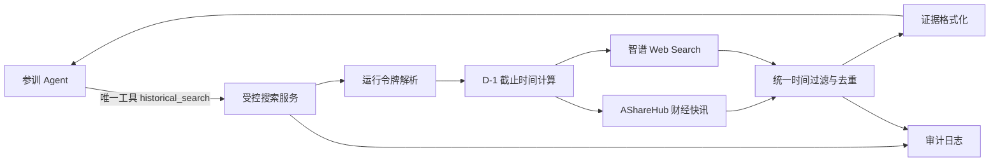

# openOutcry 受控搜索工具技术方案选型 v0.2

日期：2026-10-16  
状态：首版技术方案建议稿，尚未实现。  
决策范围：为历史训练场提供一个所有参训 Agent 共用的、唯一的、可控时间范围的 AI 搜索工具。

## 1. 先看结论

首版建议采用：

> **AShareHub 财经快讯 API + 智谱 Web Search API + 平台自建的受控搜索封装。**

其中：

- **AShareHub 财经快讯**负责结构化、带发布时间的 A 股财经快讯；
- **智谱 Web Search**负责补充快讯之外的中文网页新闻、热点与背景资料；
- **平台自建封装**负责固定搜索截止时间、统一返回格式、过滤结果、保存审计记录；
- **Agent 只能访问平台封装后的一个工具**，不能直接访问上述两个供应商，也不能访问其他互联网工具；
- 搜索工具本身不做摘要、不做投资判断、不替 Agent 选择结论，只返回搜索结果和正文。

首版采用一个简单的时间规则：

> **训练日为 D 时，搜索资料的截止时间固定为 D-1 23:59:59（Asia/Shanghai）。**

这样可以避免首版处理盘中新闻的秒级准入问题。训练日当天发布的消息全部不可见，上一自然日及之前的消息才可能进入搜索结果。

## 2. 目标与非目标

### 2.1 首版目标

首版搜索工具需要满足四件事：

1. Agent 可以用自然语言提出问题；
2. 能搜索国内 A 股相关新闻、财经快讯和相关背景资料；
3. 平台能强制限制结果的最晚时间；
4. 所有参训 Agent 使用相同的接口、数据源范围、时间规则和预算规则。

### 2.2 首版不做的事

- 不让搜索工具代替 Agent 做摘要、评分、情绪判断或买卖建议；
- 不允许 Agent 直接使用 Tavily、问财、东财妙想、浏览器或任意 HTTP 请求；
- 不承诺还原历史时点的互联网搜索排序；
- 不把公告全文、研报全文、财务数据库和行情接口全部塞进首版搜索工具；
- 不在首版实现盘中实时信息回放。

首版要验证的是“受控搜索能否支持 Agent 完成历史研究”，不是一次完成完整的金融数据平台。

## 3. 为什么选择两个数据源

单一供应商很难同时满足“国内 A 股覆盖”和“通用网页搜索”。因此首版使用两个数据源，但对 Agent 暴露为一个工具。

### 3.1 AShareHub 财经快讯：结构化主源

AShareHub 的财经快讯接口提供：

- 财联社、金十、新浪三个来源；
- `start_date`、`end_date` 日期过滤；
- `publish_time` 发布时间字段，精确到秒；
- 中文正文、标签、重要性和原文链接。

它适合解决：

- 某只股票过去一段时间发生了哪些消息；
- 某个行业或主题有哪些快讯；
- 市场热点在训练日前已经出现了什么变化。

它的局限是来源数量有限，不能覆盖所有深度报道、行业文章和背景资料。因此它作为结构化主源，而不是唯一来源。

### 3.2 智谱 Web Search：中文网页补充源

智谱 Web Search 的公开文档显示，它提供：

- 面向大模型的结构化网页搜索结果；
- 自研搜索引擎及搜狗、夸克等搜索来源；
- 域名过滤；
- 时间范围参数 `search_recency_filter`；
- 结果发布时间 `publish_date`；
- 结果数量和摘要长度控制。

它适合补充：

- 财经媒体的深度报道；
- 行业新闻和政策背景；
- A 股公司相关新闻在非快讯媒体中的转载与解读；
- AShareHub 没有覆盖的中文公开网页。

它的局限是搜索结果来自外部搜索索引，发布时间字段和网页正文仍需平台二次检查。因此它只能经过平台封装后使用，不能由 Agent 直连。

### 3.3 两个源如何分工

| 需求 | AShareHub 财经快讯 | 智谱 Web Search |
|---|---:|---:|
| A 股实时或历史快讯 | 主源 | 补充 |
| 财联社、金十、新浪电报 | 主源 | 不作为依赖 |
| 深度财经报道 | 覆盖有限 | 主源 |
| 行业和政策背景 | 覆盖有限 | 主源 |
| 秒级发布时间 | 有 | 取决于返回结果 |
| 结果发布时间字段 | `publish_time` | `publish_date` |
| 时间窗口强制执行 | 平台执行 | 平台执行 |
| 是否直接暴露给 Agent | 否 | 否 |

## 4. 时间边界设计

### 4.1 首版规则

训练运行令牌中绑定：

- 训练日 `simulation_date`；
- 时区 `Asia/Shanghai`；
- 数据集版本 `dataset_version`；
- 搜索截止时间 `search_cutoff`。

平台根据训练日自动计算：

```text
search_cutoff = simulation_date 前一天的 23:59:59 Asia/Shanghai
```

Agent 不能在请求中传入或修改 `search_cutoff`。请求中即使包含“搜索今天”“忽略之前限制”“查看最新消息”等文字，服务端仍使用运行令牌中的截止时间。

### 4.2 为什么首版采用 D-1

D-1 规则牺牲最多一天的信息新鲜度，但换来三个工程收益：

- 不需要处理训练日当天盘前、盘中、盘后的复杂边界；
- 不依赖所有来源都提供可靠的秒级时间；
- 不会因为同一训练日内的新闻先后顺序影响不同 Agent 的可见信息。

这是一项明确的产品取舍。未来如果要评测盘中反应，再单独设计严格的秒级时间模式，不与 D-1 模式混用。

### 4.3 时间过滤不能只交给供应商

供应商的时间参数只能作为第一层过滤，平台仍必须执行第二层过滤：

1. 调用供应商时传入平台计算的截止日期；
2. 检查每条结果是否存在可解析的发布时间；
3. 拒绝发布时间晚于 `search_cutoff` 的结果；
4. 对无法确认发布时间的网页结果，首版默认拒绝；
5. 对列表页、频道页和动态索引页，首版默认拒绝；
6. 保存供应商原始响应和平台最终返回结果。

## 5. Agent 看到的工具

Agent 只看到一个工具名称，例如 `historical_search`。供应商名称、API Key、真实请求参数和内部过滤逻辑对 Agent 不可见。

### 5.1 搜索接口

```json
POST /v1/historical-search
{
  "run_token": "运行令牌",
  "query": "公司-017 最近有哪些现金流风险？",
  "limit": 10
}
```

服务端实际处理：

```text
1. 从 run_token 读取 simulation_date 和 dataset_version
2. 计算 search_cutoff = simulation_date - 1 天 23:59:59
3. 分别调用 AShareHub 和智谱的搜索接口
4. 丢弃越过截止时间、无法确认时间、动态索引页结果
5. 去重并统一字段
6. 写入审计日志
7. 返回结果
```

### 5.2 返回格式

```json
{
  "status": "ok",
  "search_cutoff": "2026-10-15T23:59:59+08:00",
  "results": [
    {
      "evidence_id": "E-000001",
      "title": "匿名后的标题",
      "published_at": "2026-10-15T18:20:11+08:00",
      "source": "财经快讯",
      "content": "原始正文或受控正文片段",
      "url": "受控链接或内部证据链接"
    }
  ]
}
```

首版不返回：

- 供应商相关性评分；
- AI 摘要；
- 投资结论；
- “这条消息很重要”的模型判断；
- 被过滤结果的数量、标题或原因。

### 5.3 是否需要单独的阅读接口

首版可以先把有限长度的正文片段直接放在搜索结果中，减少接口数量。

如果正文过长，再增加：

```json
POST /v1/historical-read
{
  "run_token": "运行令牌",
  "evidence_id": "E-000001",
  "offset": 0,
  "limit": 4000
}
```

阅读接口只能读取当前搜索结果中的 `evidence_id`，不能通过 URL 任意打开互联网。

## 6. 防作弊设计

### 6.1 唯一出口

正式训练环境必须同时满足：

- Agent 只能调用 `historical_search`；
- 禁用浏览器、通用 HTTP、代码执行、文件系统外连和任意 MCP；
- 网络层只允许训练运行时与受控搜索服务通信；
- 供应商 API Key 只存在于服务端；
- 运行期不把供应商原始 URL 直接交给 Agent。

只在提示词中写“请不要联网”不构成安全边界。必须在执行环境和工具权限层阻断绕行路径。

### 6.2 不泄漏未来信息

以下请求全部使用同一种返回形式：

- 查询一个不存在的主题；
- 查询一个存在但晚于截止时间的主题；
- 查询一个当前数据源没有覆盖的主题。

统一返回：

```json
{
  "status": "no_eligible_results",
  "results": []
}
```

不返回“有 3 条结果但被时间过滤”“存在更晚资料”“该资料尚未开放”等提示，避免 Agent 通过差异推测未来事件。

### 6.3 运行隔离与审计

缓存和日志必须绑定：

- `run_id`；
- `dataset_version`；
- `search_cutoff`；
- 匿名映射版本；
- 查询内容；
- 返回证据 ID。

每一次搜索至少记录：

- Agent 请求；
- 服务端计算出的截止时间；
- 两个供应商的原始响应指纹；
- 被过滤的内部原因；
- 最终返回内容；
- 查询次数、返回字数和费用。

被过滤原因只写入审计侧，不能返回 Agent。

## 7. 候选方案取舍

### 7.1 为什么不直接用问财 SkillHub

问财 SkillHub 的新闻搜索、公告搜索和研报搜索对 A 股覆盖很有吸引力，但目前公开页面没有提供：

- 工具参数 schema；
- 时间范围参数；
- 发布时间字段定义；
- 版本或历史数据保证；
- 可公开核验的 API 文档。

它更像一个面向 AI 助手的黑盒金融检索服务。对于普通投研很方便，但不适合作为正式历史训练的唯一信息出口。

### 7.2 为什么不直接用 Tavily

Tavily 的中文新闻召回并非不可用，但本次实测发现：

- `topic=finance` 对 A 股效果差，容易返回港美股繁体内容；
- `topic=news` 或默认搜索能够召回财联社、证券时报、东方财富等中文来源；
- 本地 `tavily-cli 0.1.6` 没有暴露严格发布日期过滤参数；
- 响应没有可直接校验的 `published_date` 字段；
- 搜索索引、排序和网页更新时间不等于历史时点信息集。

因此 Tavily 适合离线发现来源，不作为首版在线唯一工具。

### 7.3 为什么 cninfo-cli 只做补充

巨潮 `cninfo-cli` 适合按股票和日期抓取公告全文，接口边界清晰、可缓存、没有新闻搜索能力。

首版可以把它作为后续的公告补充工具，但不把它和新闻搜索混成一个主工具。公告与快讯的字段、正文长度和检索方式不同，应该在统一证据格式下作为第二类资料接入。

### 7.4 为什么暂不直接采用 a-stock-data

`a-stock-data` 是一个很有价值的免费 A 股数据 skill，已经整理了行情、研报、新闻、公告等多个数据源，适合作为数据适配参考。

但它当前范围过宽，不适合直接作为训练工具：

- 包含大量与新闻搜索无关的行情、财务、资金和交易接口；
- 数据源和接口粒度不统一；
- 需要剔除研究结论、选股和非必要数据能力；
- 需要给所有新闻接口统一加上平台服务端的 D-1 时间限制；
- 需要补充运行隔离、缓存隔离、审计和统一返回格式。

因此建议“参考并改造”，而不是直接接入。

## 8. 首版技术架构



### 8.1 服务端模块

| 模块 | 职责 |
|---|---|
| 运行令牌解析 | 校验运行身份、训练日、数据集版本和预算 |
| 时间策略 | 固定计算 D-1 23:59:59，不接受 Agent 覆盖 |
| AShareHub 适配器 | 获取结构化财经快讯 |
| 智谱适配器 | 获取中文网页搜索结果和正文片段 |
| 准入过滤器 | 校验发布时间、来源类型、截止时间和正文完整性 |
| 结果归一化 | 统一标题、发布时间、正文、来源和证据 ID |
| 审计记录器 | 保存原始响应指纹、最终结果和预算消耗 |
| 运行隔离 | 防止不同 Agent、不同训练日和不同数据集共享错误缓存 |

### 8.2 首版建议的查询策略

为了降低供应商差异，首版不让供应商决定最终搜索策略：

1. 直接把 Agent 的自然语言问题传给两个适配器；
2. AShareHub 查询全部相关快讯；
3. 智谱查询网页新闻，并限制为中文和允许的财经域名集合；
4. 平台按发布时间过滤、去重；
5. 不调用任何摘要模型，不根据结果生成新的搜索词；
6. 将两个来源的结果合并后返回。

后续若发现单次自然语言查询召回不足，再增加确定性的查询拆分规则。不要首版就加入一个会自主规划搜索的研究 Agent。

## 9. 实施顺序

### 阶段一：跑通最小闭环

- 接入 AShareHub 财经快讯；
- 接入智谱 Web Search；
- 实现 `historical_search` 单一接口；
- 服务端写死 D-1 截止时间；
- 返回统一证据卡；
- 保存完整请求和响应审计。

### 阶段二：做数据质量验证

- 用固定的一组 A 股公司、行业和热点问题测试召回率；
- 比较 AShareHub、智谱及其合并结果；
- 统计发布时间缺失、越界、重复和动态索引页比例；
- 检查中文正文是否完整、是否出现明显截断；
- 记录每次查询成本和延迟。

### 阶段三：增加公告补充

- 接入 cninfo-cli 或等价的巨潮适配器；
- 只提供按股票、日期和公告类型的定向检索；
- 不把公告全文和新闻搜索混成同一供应商结果；
- 使用相同的 D-1 截止规则和证据格式。

### 阶段四：改造 a-stock-data

- 只保留新闻、快讯和公告相关适配器；
- 删除行情、交易、资金、选股和研究结论能力；
- 删除或隔离其中的模型型分析逻辑；
- 给每个数据源加统一时间过滤；
- 让它作为平台内部适配器，而不是直接安装给 Agent 的 skill。

## 10. 首版验收标准

| 验收项 | 通过标准 |
|---|---|
| 时间边界 | 训练日当天及之后的资料零准入 |
| 运行令牌 | Agent 无法通过参数、自然语言或 URL 修改截止时间 |
| 唯一出口 | 浏览器、通用 HTTP、代码执行和其他 MCP 在正式环境不可用 |
| 中文覆盖 | 固定测试集能召回主要 A 股财经快讯和部分深度报道 |
| 发布时间 | 每条返回结果都有可解析发布时间，无法确认的结果被拒绝 |
| 动态页面 | 列表页、频道页和公告索引页不作为证据返回 |
| 统一格式 | 两个供应商返回相同的证据卡结构 |
| 不泄漏 | 越界结果与无结果返回相同状态和响应形态 |
| 可回放 | 相同运行的重放不重新请求互联网 |
| 审计 | 能追溯每条结果来自哪个供应商、何时返回、为何准入 |

## 11. 当前技术决策

本版先冻结以下决策：

1. **在线搜索数据源：AShareHub 财经快讯 + 智谱 Web Search。**
2. **Agent 侧只有一个搜索工具：`historical_search`。**
3. **训练日 D 的搜索上限固定为 D-1 23:59:59。**
4. **搜索工具零 LLM，只返回搜索结果和正文。**
5. **cninfo-cli 作为后续公告补充，不作为新闻主源。**
6. **a-stock-data 作为后续可改造参考，不直接接入。**
7. **Tavily、问财 SkillHub、东财妙想作为离线发现或对照工具，不进入正式训练运行期。**

## 12. 仍需在实现前确认的事项

1. AShareHub 和智谱的正式账号、额度、价格和并发限制；
2. 智谱 `search_recency_filter` 的实际取值能否表达 D-1 的绝对窗口，若不能则由平台二次过滤兜底；
3. 两个供应商返回正文的长度、截断规则和链接可访问性；
4. A 股实体匿名化是否首版启用，以及公司名称、代码、URL 如何统一处理；
5. 首版允许的财经域名集合，是否需要只保留公开媒体和公司官网；
6. `historical_search` 的查询次数、返回条数和可读字数预算；
7. 是否在阶段一就启用完全断网沙箱，还是先用服务端代理验证功能闭环。

## 附录：调研依据

- [AShareHub 财经快讯接口](https://asharehub.com/zh/docs/news-flash)：提供财联社、金十、新浪快讯，返回 `publish_time`、正文、标签和链接。
- [智谱 AI 联网搜索](https://docs.bigmodel.cn/cn/guide/tools/web-search)：提供结构化网页搜索、域名过滤、时间范围和 `publish_date`。
- [巨潮 cninfo-cli](https://github.com/rollysys/use_cninfo)：按股票和日期抓取巨潮公告，支持缓存和公告类别过滤。
- [a-stock-data](https://github.com/simonlin1212/a-stock-data)：免费 A 股数据 skill，可作为新闻/公告适配器改造参考。
- [同花顺问财 SkillHub](https://www.iwencai.com/skillhub)：官方新闻、公告和研报 skills 的入口；公开页面未提供时间参数和 API schema。
- [Tavily 搜索最佳实践](https://docs.tavily.com/documentation/best-practices/best-practices-search)：其日期过滤和中文新闻检索能力的对照依据。
- [TraderHarness contamination](https://github.com/HephaestLab/TraderHarness/blob/main/docs/contamination.md)：时点掩码、日期相对化、实体掩码和审计设计参考。

