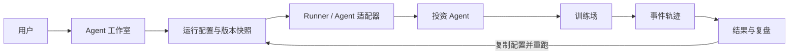
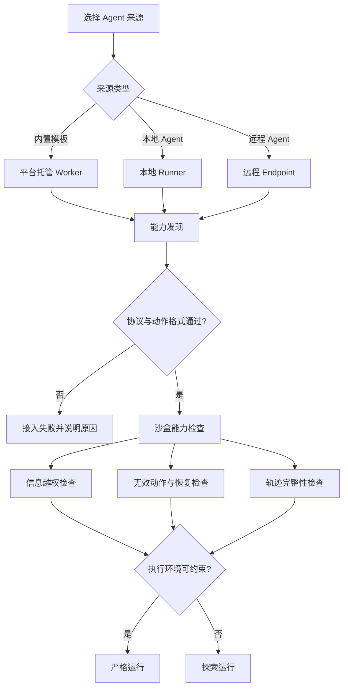
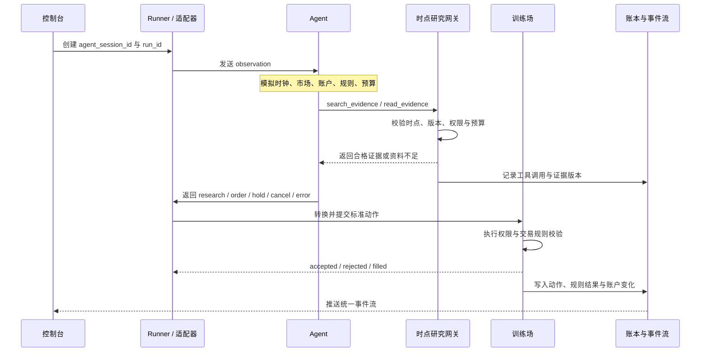
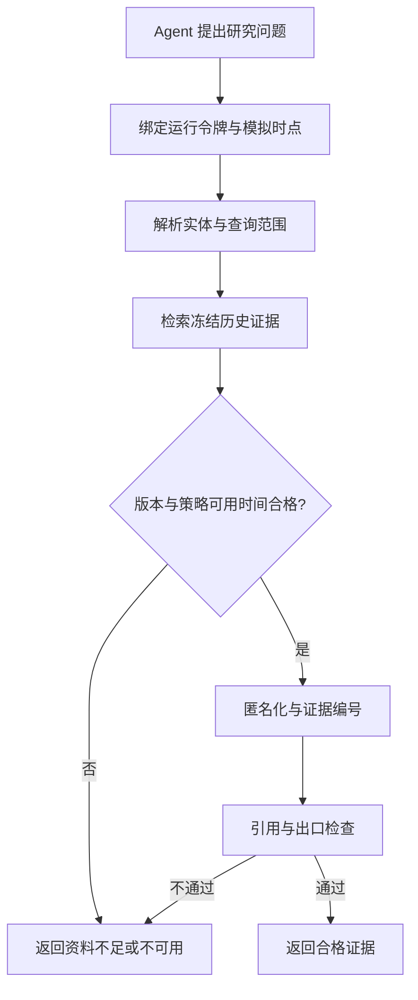
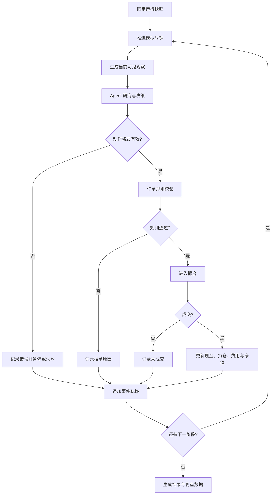
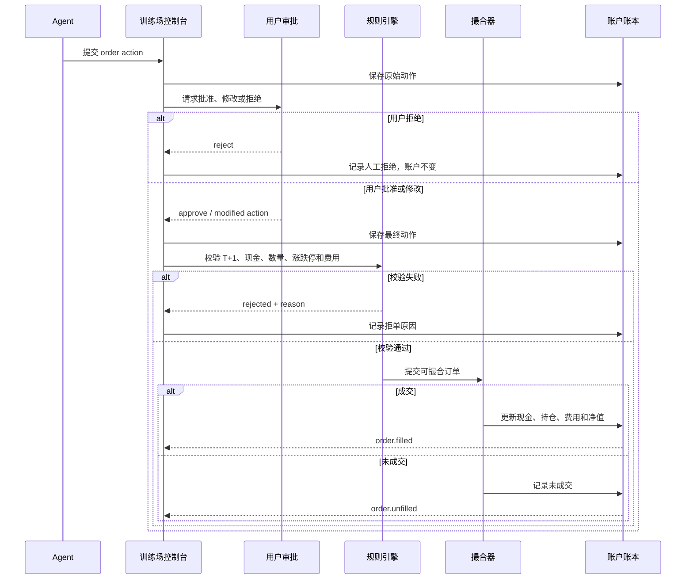
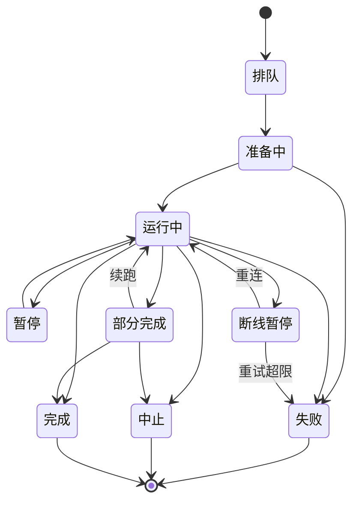
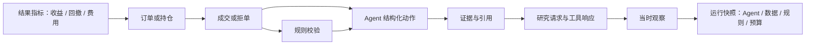
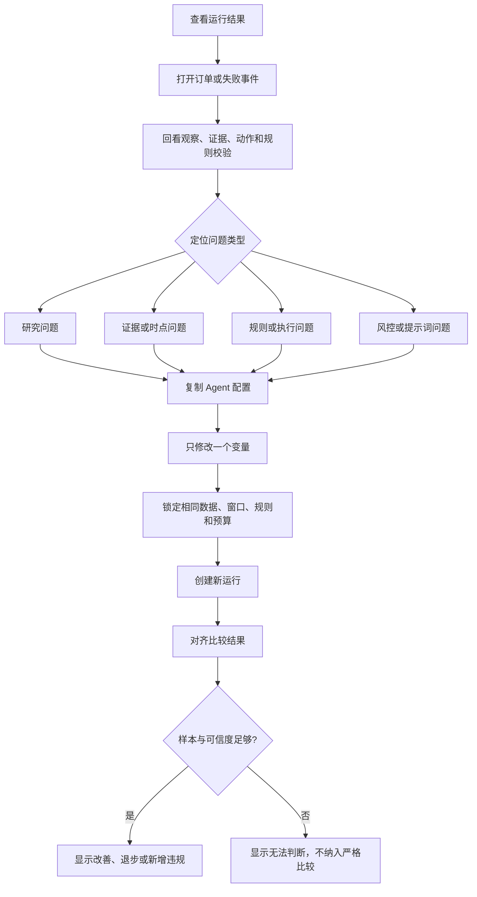

import { CodeDemo } from '@/docs/CodeDemo'
import { MandateTicket } from '@/components/studio/MandateTicket'
import mandateSource from '@/components/studio/MandateTicket.tsx?raw'
import { ProposalTicket } from '@/components/proposal/ProposalTicket'
import proposalSource from '@/components/proposal/ProposalTicket.tsx?raw'
import { WorkbenchTabs } from '@/components/run/WorkbenchTabs'
import workbenchTabsSource from '@/components/run/WorkbenchTabs.tsx?raw'
import { EquityChart } from '@/components/charts/EquityChart'
import equitySource from '@/components/charts/EquityChart.tsx?raw'
import { BENCH_SERIES, NAV_SERIES } from '@/data/market'

# openOutcry 产品设计与功能（MVP）

> **权威版本基线**：飞书知识库 revision 289（2026-10-30 14:22） · MDX 实时组件版  
> 本文件直接在正文中引入并挂载 `openoutcry-web` 的真实前端组件与源码（通过 `<CodeDemo>` 与 `?raw` 同步读取），代码改动即刻反映在产品文档演示中。

---

## 产品定位

openOutcry 是面向 A 股投资 Agent 的运行与评测环境。用户将 Agent 放入固定的历史市场条件中，使其基于当时可见的信息研究、决策并提交模拟交易，再通过可追溯的运行结果评估和改进 Agent。

首版的“训练”指 Agent 配置迭代、模拟运行与复盘，不包含自动更新模型权重。产品只进行模拟交易，不连接真实券商或执行真实下单。

**核心流程：** 接入 Agent → 配置并启动训练场 → 观察运行与交易 → 查看结果和决策依据 → 调整 Agent 后重跑。

这条主线说明产品不是单独的 Agent 配置页、回测曲线或聊天窗口，而是一个可以反复迭代的运行闭环。

## 1. Agent 接入与配置

### 目标

让用户能够选择或接入 Agent，并支持对 Agent 的自由配置（模型、提示词、交易策略、在团队中的角色、允许调用的工具）。

### 核心功能

- 从内置 Agent 模板开始，或选择外部 Agent 作为运行来源。
- 配置模型标识、系统提示词、结构化动作格式和研究流程。
- 选择允许使用的研究工具，并设置调用次数、Token 与运行成本预算。
- 保存、复制 Agent 配置版本；已开始的运行绑定固定版本。
- 启动前检查连接状态、观察输入和动作输出格式；检查失败时显示原因，不静默替换配置或工具。
- 提供丰富的支持自定义的能力（需技术调研）。

<CodeDemo
  title="训练委托单（时段 × 标的池 × 团队 × 规则）"
  file="src/components/studio/MandateTicket.tsx"
  code={mandateSource}
  caption="在上方直接切换起止日期、标的池或勾选多位 Agent（按顺序分配交易 / 研究 / 风控角色），切换到「前端源码」可查看真实 TSX 实现。"
>
  
section]:mt-0">
    <MandateTicket />
  

</CodeDemo>

### 外部 Agent 边界

平台向 Agent 提供带运行 ID 和模拟时钟的市场观察、账户、证据、规则与预算。Agent 可提出研究请求、订单、持有、取消或错误状态；平台负责权限校验、订单校验、撮合和账户变更。外部 Agent 不能直接读取或修改交易账本。

运行记录保留外部 Agent 的原始输入、原始输出、标准化动作、错误与适配器版本。执行环境无法验证是否受控的接入标记为探索运行，不纳入严格比较。

### 接入流程与评测资格

接入成功只代表会话可以建立，不代表 Agent 已经具备严格评测资格。平台需要分别检查动作格式、信息边界、运行恢复能力和轨迹完整性。

严格运行要求平台能够实际约束网络、文件和工具权限；仅凭 Agent 自报日志不能获得严格评测资格。

### Agent 与平台如何交互

Agent 负责提出研究请求和标准动作，平台负责提供受控观察、校验动作、撮合交易和更新账本。两者通过运行 ID 和模拟时钟绑定到同一次运行。

## 2. 训练场

### 目标

在固定、可说明的历史条件下运行 Agent，让用户能够同时观察 AI 会话、研究过程、订单状态、账户持仓与盈亏，理解每项决策如何影响模拟账户。

### 运行配置

每次运行固定 Agent 与模型版本、提示词、数据和证据版本、股票池、历史窗口、初始资金、交易规则、研究预算及人工介入设置。运行开始后配置不可变；修改配置应创建新版本和新运行。

### 核心运行能力

- 提供明确的模拟时钟与阶段；首版聚焦日频 A 股历史运行。
- 只向 Agent 提供该决策时点已满足可用条件的信息，避免未来信息泄漏。
- 记录研究请求、实际返回证据、Agent 动作、规则校验、订单状态、账户变化、错误与预算消耗。
- 按明确的 A 股基础规则校验交易，包括 T+1、停牌、涨跌停、交易数量、现金、持仓与费用。
- 将订单提案、规则校验、成交或拒绝分开记录；订单获批或提交不等于成交。
- 支持查看运行状态和中止运行；中止后保留已发生的账户与事件，不补算未运行时段的结果。
- 支持原轨迹回放，不重新调用模型或互联网；重新推理创建新的运行记录。

### 页面呈现

两个页面：一个页面用于新建训练，一个页面用于看实时训练和以往训练。

训练场以同一工作页面呈现 AI 会话与模拟账户。会话区按时间展示观察、研究、证据、动作与订单；账户区展示净值、现金、持仓、历史操作和盈亏。事件详情可查看证据、动作格式、规则校验及账户影响；高级边界与运行配置按需展开。

**运行闭环：** 固定运行快照 → 提供时点观察 → Agent 研究与决策 → 校验订单 → 撮合并更新账本 → 保存事件轨迹。

<CodeDemo
  title="订单审批票据与平台 T+1 持仓账本"
  file="src/components/proposal/ProposalTicket.tsx"
  code={proposalSource}
  caption="可交互演示：点击加减号调整股数、点击「批准」提交提案，再点击「演示开盘撮合」，右侧平台账本与 T+1 可卖股数将实时联动更新，并保留原始提案与人工修改双轨记录。"
>
  

    
[data-slot=card]]:mt-0">
      <ProposalTicket />
    

    

      <WorkbenchTabs />
    

  

</CodeDemo>

<CodeDemo
  title="运行台账 · 一张卡四个页签"
  file="src/components/run/WorkbenchTabs.tsx"
  code={workbenchTabsSource}
  caption="账户、持仓、成交与运行状态合并成同一张卡的四个页签：同类信息用页签切换，而不是竖着摞四张卡片。数据由 RunStore 选择器统一派生。"
>
  <WorkbenchTabs />
</CodeDemo>

### 受控研究与时点信息

训练场中的“搜索”不是普通互联网搜索。每次研究请求都绑定运行令牌和模拟时点，只有版本身份和可用时间合格的历史证据才能返回给 Agent。

### 一次训练如何运行

这条流程将“研究、动作、校验、撮合、账本和复盘”连成一个可审计的运行过程。训练场的结果不是 Agent 自己报告的数字，而是由平台账本根据已记录事件计算得到。

### 订单从提案到成交

订单提案、人工处理、规则校验和实际撮合是不同阶段。批准订单只表示允许进入后续流程，不代表已经成交。

### 运行状态

断线、动作解析失败、资料时点冲突、预算耗尽和用户中止都必须保留已发生的事件与账户状态，不自动切换 Agent，也不补写未运行时段的收益。

## 3. 结果与复盘

### 目标

说明一次运行的表现、交易行为与决策依据，帮助用户定位 Agent 的问题，并在相同条件下验证配置改动。

### 核心功能

- 展示账户净值、累计净收益、基准表现、最大回撤、成交与费用，并说明指标口径。
- 查看当前持仓、历史操作及各笔交易对应的已实现或浮动盈亏。
- 按模拟时间回看观察、证据、Agent 动作、规则校验、成交或拒绝及账户变化。
- 从任一订单追溯到当时的观察、证据版本、结构化动作与执行结果。
- 复制 Agent 配置，在相同数据、窗口、规则与预算下创建新运行并比较版本。
- 导出脱敏的运行事件记录；不导出模型密钥或其他敏感凭据。

样本不足或运行可信度不满足要求时明确显示“无法判断”或探索运行，不以单次收益证明策略能力，也不将未经验证的运行混入严格比较。

<CodeDemo
  title="松绿漆板净值与沪深 300 基准对比曲线"
  file="src/components/charts/EquityChart.tsx"
  code={equitySource}
  caption="SVG 净值对比组件直接读取 tokens.css 图表色板（A 股红涨绿跌），与主站复盘页完全同源。"
>
  

    

      <b>Equity vs Benchmark</b>
      净值 · 基准 = 100,000
    

    

      <EquityChart nav={NAV_SERIES} bench={BENCH_SERIES} />
    

    

      <i className="chart-swatch-agent" />Agent 净值
      <i className="chart-swatch-bench" />沪深 300
      <i className="chart-swatch-zero" />零轴
    

  

</CodeDemo>

### 结果如何追溯

结果页不只回答“赚了多少钱”，还要回答“哪一次观察和哪条证据导致了这笔交易，以及平台如何计算出最终结果”。

每个结果指标、订单和持仓都应能沿着这条链路回到运行快照。原轨迹回放只读取已经保存的事件，不重新调用模型、互联网或修改账户；重新推理则复制配置并创建新的运行 ID。

### 从复盘到下一轮改进

有效改进的最小单位是“定位一个问题、修改一个变量、在相同条件下重跑”。首版不自动搜索提示词，也不把单次收益改善直接解释为 Agent 能力提升。

## MVP 范围与边界

- 首版聚焦日频 A 股历史模拟、固定运行条件、Agent 接入、交易过程记录与结果复盘。
- 不连接真实券商，不执行真实交易，不承诺收益或投资能力认证。
- 不承诺任意远程 Agent 即插即用；网络、文件与工具隔离无法验证时，不作为严格评测运行。
- 暂不覆盖完整分钟级撮合、复杂公司行为、公共榜单、自动提示词搜索与在线强化学习。
- 人工确认、修改订单或追加指导必须留痕，并与自主运行区分。

## 下一步计划

我们的技术方案，总体要对三个部分进行设计：前端、后端、Agent。

- **前端**：交互优化；工程细节；MDX 交互式文档站建设。
- **后端**：获取 A 股历史数据源、确定性撮合与平台账本、存储 Agent 训练与事件轨迹数据。
- **Agent**：平台提供的 Skills 与 MCP 受控搜索工具；多智能体团队编排（主 Agent 调度 Sub-agents vs 固定 Workflow）。
- **UI 体验优化**：清晰记录并展示 Agent 的历史交易数据与历史工具调用链路。
- **训练后复盘**：探索提供 Review Skills 对交易轨迹做结构化点评与归因复盘。
