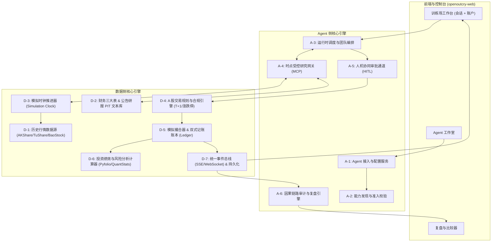

# openOutcry 后端功能规划与调研清单

> 对应产品文档：[`openOutcry 产品设计与功能（MVP）`](./openOutcry-产品设计与功能-MVP.md)  
> 文档定位：后端架构设计与实现需求清单（技术落地与逐项调研指南）  
> 编写时间：2026-11-05  

---

## 0. 后端定位与架构总览

在 openOutcry 平台中，后端不仅是常规的 API CRUD 数据服务，更是保障“**可复现、防未来信息泄漏、全因果追溯**”的核心底座，在整个系统闭环中承担“**四位一体**”的职责：

1. **历史时空路由器（Point-in-Time, PIT Router）**：负责严格冻结与截断历史截面数据，向 Agent 仅提供模拟决策当时“合法可见”的市场行情、公告与财报，彻底杜绝前瞻偏误与未来信息污染；
2. **合规裁判与规则引擎（Compliance & Rule Engine）**：独立于 Agent 做出权威校验，强制落地 A 股特有的 T+1、涨跌停、停牌、资金、申报手与交易税费限制；
3. **模拟撮合与记账底座（Matching & Double-Entry Ledger）**：根据真实历史行情模拟撮合成交，并维护不可篡改的双式记账账户体系；
4. **审计公证处与因果追踪器（Causality Tracer & Replayer）**：记录“观察 -> 工具调用 -> 证据引用 -> 决策动作 -> 规则校验 -> 撮合结果 -> 净值变动”的完整因果链条，支撑零重新推理的原轨迹回放与单变量重跑对齐。



---

## 一、Agent 侧功能清单

Agent 侧负责智能体的注册接入、协议标准化、团队协同编排、受控工具网关与全链路决策归因。

### A-1. Agent 接入与配置服务（Agent Registry & Studio）
- **核心职责**：
  - 管理 Agent 资产与配置，支持内置模板 Agent（单分析师、多角色投研团队）以及外部自定义 Agent。
  - 外部 Agent 来源支持：本地 Runner（CLI / Docker 容器）与远程端点（HTTP POST / OpenAI 兼容接口）。
  - 配置版本化管理：模型标识（Provider/Model Name）、系统提示词、角色定义、结构化动作 Schema、可用工具白名单、Token/调用次数/耗时预算。
  - 深度不可变快照（Immutable Run Snapshot）：一旦启动训练场，运行实例（`run_id`）强制深度绑定固定版本配置，后续修改配置自动派生新版本。
- **工程难点**：
  - 差异对比（Diff Engine）：精准比较两个版本在提示词、模型、工具或参数上的变更。
  - 凭据安全：模型 API Key 的安全加解密，多用户环境下的密钥隔离。
- **调研重点**：
  - 模型网关方案（OneAPI / LiteLLM / 官方 SDK 直连）。
  - Agent 配置 Schema 设计（采用 JSON Schema / Pydantic 定义）。

### A-2. 能力发现与准入校验（Agent Handshake & Validator）
- **核心职责**：
  - 在训练启动前执行握手预检（Handshake Protocol），探测 Agent 连接可用性。
  - 动作协议有效性校验：检查 Agent 是否能严格返回符合约定的标准动作格式（`research`、`order`、`hold`、`cancel`、`error`）。
  - 执行沙盒与边界审查：探测 Agent 执行环境是否可受控（网络隔离、文件权限、工具调用是否强制走平台代理）。
  - 评测等级标记：
    - **严格评测运行（Strict Run）**：平台可约束网络、文件与工具权限，轨迹防篡改；
    - **探索运行（Exploratory Run）**：环境不可验证或存在自报日志嫌疑，标记保留但不纳入正式评测比对。
- **工程难点**：
  - 阻断原因精准诊断：握手失败时明确说明阻断细节（如格式错误具体字段、超时或非法连接），不静默替换配置。
- **调研重点**：
  - 通信协议格式：标准化 JSON-RPC 2.0 vs RESTful vs Server-Sent Events 流式协议。
  - 容器隔离方案：Docker 沙盒、gVisor 或安全网络命名空间隔离。

### A-3. 运行时调度与团队编排引擎（Agent Runtime Orchestrator）
- **核心职责**：
  - 驱动 Agent 在指定模拟交易日执行“盘前分析 -> 盘中交易决策 -> 盘后总结”生命周期。
  - 支持两种主流协作形态：
    1. **主 Agent 自主调度（ReAct / Sub-Agents）**：由总控调度器自主唤起宏观分析师、行业分析师或技术分析师；
    2. **有向无环工作流（Workflow / DAG）**：按预设流水线固定先后步骤（如：数据汇总 -> 行业筛选 -> 风控审核 -> 最终下单）。
  - 步进容错与格式自愈（Self-Healing / JSON Repair）：模型输出格式异常时，通过重试提示词（Repair Prompt）要求其自我纠错，达到重试上限后触发安全降级（发出 `error` 动作并记录）。
  - 熔断与超时管理：单步推理超时（如 60s）、单日预算耗尽保护。
- **工程难点**：
  - 多智能体辩论与串并行调用的上下文膨胀控制与延迟优化。
  - 状态断点保存与恢复：训练暂停或断线后可无缝从断点继续推进。
- **调研重点**：
  - 编排框架调研：LangGraph、AutoGen、TradingAgents 内核架构、自研轻量级 Async 状态机。

### A-4. 时点受控研究网关（PIT Research Gateway & MCP Tools）
- **核心职责**：
  - 向 Agent 开放统一的研报检索、财务数据、K线走势查询工具集。
  - 强制注入时点约束：工具调用必须携带 `run_id` 和当前模拟时钟 `simulated_time`，网关在底层执行时间过滤器，**任何晚于该时点的公开数据均不可返回**。
  - 工具标准化接口（标准 MCP 工具）：
    - `search_evidence(query, filters)`：时点切片研报/新闻/公告搜索；
    - `read_evidence(evidence_id)`：证据全文读取；
    - `get_financial_statement(ticker, statement_type)`：截至模拟日真实披露的财报三大表；
    - `get_market_snapshot(ticker, window)`：历史日线行情观察。
  - 证据编号与引用存证：为返回的每条信息分配全局唯一证据 ID（`evidence_id`），记录 Agent 决策是否以及如何引用该证据。
- **工程难点**：
  - 避免前瞻偏误（Look-ahead Bias）：特别是财报与公告的披露时间（Announcement Date）严格校验。
  - 标的脱敏（可选能力）：支持对股票代码和名称进行动态别名替换，防止模型通过预训练记忆逆向推断未来走势。
- **调研重点**：
  - Anthropic MCP (Model Context Protocol) 规范集成。
  - 文本切片向量与全文混合检索（Hybrid Search）的 PIT 时点过滤实现。

### A-5. 人机协同审批通道（HITL / Human-in-the-Loop）
- **核心职责**：
  - 在 Agent 提交交易意图（`order action`）后，挂起撮合流程并向控制台推送待审批事件。
  - 允许用户进行三类操作：批准（Approve）、修改订单参数（Modify，如改数量/改价格）、拒绝订单（Reject）。
  - 审计留痕：在事件流和账户账本中永久标记人工介入标记（Human-intervened），并在复盘中区分纯自主决策与有人工干预的决策。
- **工程难点**：
  - 异步阻塞与超时策略：前端未响应时超时自动拒单或按配置默认放行。
- **调研重点**：
  - 长时运行工作流的人机交互模式设计（WebSocket 实时交互协议 / Webhook 回调）。

### A-6. 全链路因果审计与复盘引擎（Causality Tracer & Replayer）
- **核心职责**：
  - 建立全链路因果关系图：最终净值变动 -> 撮合成交记录 -> 规则校验结果 -> Agent 结构化动作 -> 引用的证据编号 -> 工具调用上下文 -> 当日初始市场观察。
  - **原轨迹回放（Trace Replay）**：零调用大模型、零调用外部数据源，仅依赖事件库中已固化的事件流，以 1x/2x/5x 速度在前端高保真重现当时的会话与账本演变。
  - **单变量重跑比较器（Diff Runner）**：支持“复制配置 -> 锁定完全相同的历史时窗、标的池、数据快照与初始资金 -> 仅修改一个变量（如调低风控止损线或修改提示词） -> 重新运行并生成对齐收益差异图”。
- **工程难点**：
  - 因果溯源链的数据建模与多表关联合并查询效率。
  - 轨迹脱敏导出（导出完整 JSON 事件日志时过滤 API 密钥等敏感信息）。
- **调研重点**：
  - OpenTelemetry / 类似 Trace 架构在 LLM 决策图谱中的应用。
  - 事件存储模型设计（Event Sourcing Pattern）。

---

## 二、数据侧功能清单

数据侧负责市场数据的供给、时点截断引擎、A 股交易规则与合规校验、撮合与双式记账、绩效指标计算。

### D-1. A 股历史行情数据源与处理（Market Data Ingestion）
- **核心职责**：
  - 采集与离线存储 A 股历史全市场日线行情（代码、交易日、开盘价、最高价、最低价、收盘价、成交量、成交额、振幅、换手率等）。
  - 股本与复权因子计算：支持不复权、前复权（QFQ）、后复权（HFQ），模拟撮合必须使用真实历史不复权价格（防止未来送转股除权带来的未来函数）。
  - 基准指数数据：上证指数（000001.SH）、沪深300（000300.SH）、中证500（000905.SH）、中证1000（000852.SH）日线行情。
  - 行业分类体系：申万一级/二级行业、中信行业分类映射表。
- **工程难点**：
  - 数据源更新成本、调用配额限制与历史数据清洗补全（处理异常跳空、缺失值填补）。
  - 高性能本地存储格式（秒级加载指定历史窗口的几百只股票时序）。
- **调研重点**：
  - 数据源选型横向对比：AKShare、TuShare Pro、BaoStock、Qlib 数据集。
  - 存储引擎选型：DuckDB、Parquet 宽表、PostgreSQL + TimescaleDB、ClickHouse。

### D-2. 基本面与研报/公告文本数据（Financial & Textual Data - PIT）
- **核心职责**：
  - 财务报表数据：资产负债表、利润表、现金流量表、主要财务比率（ROE、PE-TTM、PB、股息率、资产负债率等）。
  - **时点真实性（Point-in-Time, PIT）管理**：
    - 严防“财报报告期”与“实际公布披露日”的错位（例如 2023 年三季报报告期为 2023-09-30，但实际公告日期为 2023-10-28）；
    - 记录财报更正（Restatement）历史，Agent 只能看到该日期前披露的原始财报。
  - 机构研报摘要、公司重大公告历史文本切片。
- **工程难点**：
  - PIT 财务数据的获取成本高昂（多数免费源只提供当前数据库最新快照，缺少披露日期戳与更正链条）。
  - 文本切片与时点标签关联索引。
- **调研重点**：
  - 开源/免费源中支持披露日（Publish Date / Announce Date）的财报接口（如 TuShare 的 `fina_indicator_vip` / `income_vip` 中带有披露日期）。
  - 轻量级本地向量库选型（Pgvector vs Chroma vs Qdrant）。

### D-3. 模拟时钟推进器与时点引擎（Simulation Clock & As-Of Engine）
- **核心职责**：
  - 交易日历管理：严格遵循中国 A 股交易日历（剔除周末、法定节假日与调休）。
  - 阶段推进器（Phase Progression）：
    - **Phase 1: 盘前（Pre-Market）**：模拟时钟指向 T 日 09:00，生成当日行情观察与宏观新闻；
    - **Phase 2: 盘中（Trading Session）**：模拟时钟推进至 T 日 09:30~15:00，接收 Agent 决策意图；
    - **Phase 3: 盘后（Post-Market）**：模拟时钟推进至 T 日 15:00 之后，执行撮合入账、净值核算、冻结释放，保存当日结算日记。
  - 动态股票池快照（Universe Filter）：支持按历史截面选择股票池（如“2023-01-01 当时的沪深300成分股”），避免把后来才被纳入的股票提前选入（防幸存者偏差）。
- **工程难点**：
  - 模拟时钟的单步步进（Step-by-step）与批量快进（Run-to-completion）模式平滑切换。
- **调研重点**：
  - 开源交易日历库：`exchange_calendars`、`chinesecalendar`。
  - 模拟时钟驱动模式设计（同步时钟步进 vs 异步事件循环驱动）。

### D-4. A 股交易规则与合规校验引擎（A-Share Compliance Rule Engine）
- **核心职责**：
  - **T+1 制度校验**：当日买入的股份当日处于“未解冻”状态，不可卖出；次日开市自动转为可用持仓。
  - **涨跌停限制拦截**：
    - 主板股票限制 ±10%，创业板/科创板限制 ±20%，ST/ST* 股票限制 ±5%，北交所限制 ±30%；
    - 涨停板禁止买入（排队无法买进，判定为不可成交或拒单），跌停板禁止卖出。
  - **停复牌拦截**：停牌股票不可交易，提交订单直接判定为废单并记录原因。
  - **最小交易单位**：买入申报数量必须是 100 股的整数倍（整手）；卖出可分批出尽碎股。
  - **资金与持仓充盈性校验**：严禁裸卖空（A 股无做空环境默认不允许透支持仓），买入金额 + 预估手续费不得超出可用现金。
  - **交易税费模型**：
    - 印花税：仅在卖出（出让方）时单边征收（目前标准为成交金额的 0.05%）；
    - 券商佣金：双边征收（如万分之 2.5，单笔最低 5 元）；
    - 过户费：双边征收（如十万分之 1）。
- **工程难点**：
  - 规则链解耦：将交易规则设计为责任链或插件流水线，便于后续拓展港股、美股或期货规则。
- **调研重点**：
  - 开源量化框架交易规则实现（RQAlpha、Qlib、Backtrader 的 A 股适配层经验）。

### D-5. 模拟撮合器与双式记账系统（Matching & Double-Entry Ledger）
- **核心职责**：
  - **撮合机制**：
    - 日频模式支持三种成交价基准：次日开盘价（Next Open）、当日收盘价（Close）或日内成交均价（VWAP）；
    - 流动性与容量约束：单笔成交量不能超过当日全市场真实成交量的固定比例（如 5%~10%），防范虚假巨额成交。
    - 滑点模型（Slippage）：支持固定点数滑点或成交额比例滑点，模拟买入抬价与卖出折价。
  - **双式记账（Double-Entry Ledger）**：
    - 维护账户核心科目：可用现金（Cash）、冻结资金（Frozen）、股票持仓（Positions）、已实现盈亏（Realized PnL）、费用支出（Fees）；
    - 持仓成本计算：严格采用移动加权平均成本法（Weighted Average Cost）；
    - 每日收盘对账：核算当日浮动盈亏（Unrealized PnL）与总资产净值（Total Asset Value）。
- **工程难点**：
  - 高精度浮点计算：采用 Decimal 类型避免浮点数精度丢失导致账目差一分钱。
  - 事务一致性（ACID）：并发撮合与账本状态变更的原子性。
- **调研重点**：
  - 金融记账系统模型设计（借贷平衡原则、不可变日志记账）。

### D-6. 投资绩效与风险分析计算器（Performance & Risk Analytics）
- **核心职责**：
  - 每日收盘后计算累计收益与基准超额：
    - 账户净值序列（Equity Curve）、日收益率序列（Daily Returns）；
    - 对比基准净值序列（如沪深300同期走势），计算 Alpha 与 Beta。
  - 风险与投资风格量化指标：
    - **最大回撤（Max Drawdown）** 及回撤起止日期、回撤修复天数；
    - **年化收益率（Annualized Return）**（以 242/252 个交易日折算）；
    - **年化波动率（Volatility）**；
    - **夏普比率（Sharpe Ratio）** 与 **索提诺比率（Sortino Ratio）**（区分下行风险）；
    - **卡玛比率（Calmar Ratio）**（年化收益 / 最大回撤）；
    - **交易胜率（Win Rate）**、**盈亏比（Profit-Loss Ratio）**、**平均持仓天数**。
- **工程难点**：
  - 样本不足时的可信度标记：交易次数过少（如只有 1~2 笔交易）时前端标记“样本不足，无法评估”，避免虚假高分。
- **调研重点**：
  - Python 量化指标库成熟方案：`pyfolio`、`quantstats`、`empyrical`、`ffn`。

### D-7. 统一事件总线与持久化（Event Bus & Real-time Sync）
- **核心职责**：
  - 统一领域事件契约定义（Domain Events）：
    - `session.created`, `clock.stepped`, `observation.emitted`, `tool.invoked`, `evidence.returned`, `action.proposed`, `order.checked`, `order.filled`, `order.rejected`, `account.updated`, `run.completed` 等。
  - 实时推送机制：通过 Server-Sent Events (SSE) 或 WebSocket 向 Web 前端实时广播会话交互与账户变动。
  - 持久化分层：
    - 关系型数据库：存储用户、实验配置、版本快照、账户账本、交易订单、绩效指标；
    - 事件/日志库：顺序追加持久化全量 Event Log。
- **工程难点**：
  - 长时训练的断线重连与增量事件拉取（基于 `last_event_seq` 补发丢失事件）。
- **调研重点**：
  - FastAPI + SSE / WebSocket 流式推流。
  - 数据库方案：PostgreSQL（主关系库 + JSONB 存储动作结构体） + Redis（Pub/Sub 与时钟状态）。

---

## 三、推荐技术栈基线

| 层次 | 推荐技术组件 | 选型理由 |
|---|---|---|
| **开发语言** | **Python 3.11+** | 兼顾 AI Agent 生态（LangChain/LangGraph/AutoGen/MCP）与金融量化生态（Pandas/Numpy/AKShare/Qlib），是 AI+量化不可替代的第一语言。 |
| **Web 框架** | **FastAPI** | 高性能原生异步支持（Asyncio）、自动生成 OpenAPI 文档、轻量级 SSE/WebSocket 双工推流、天然契合 Pydantic 类型校验。 |
| **关系型主数据库** | **PostgreSQL 16** | 工业级 ACID 事务安全、强大的 JSONB 查询索引、原生扩展支持（Pgvector 向量检索、TimescaleDB 时序优化）。 |
| **缓存与实时消息** | **Redis** | 毫秒级锁与会话状态管理、Pub/Sub 事件发布订阅、模拟时钟心跳。 |
| **量化核心计算库** | **Pandas / Numpy / QuantStats / Empyrical** | 经过华尔街和开源界充分实测的收益率、最大回撤、夏普比率计算标准库。 |
| **时点行情与数据** | **AKShare / BaoStock / TuShare Pro** | 组合选型，兼顾日线行情的低成本获取与 PIT 财务数据的高准确性。 |

---

## 四、后续逐项调研路线图

为了有的放矢、稳步推进，建议将以上 13 个功能模块划分为 **5 个批次** 逐个展开深度调研：

```
第一批：数据底座与时点行情 (D-1, D-2, D-3)
  └── 解决数据从哪里来、如何保证时点切片（PIT）、如何推进历史交易日历。

第二批：交易规则与撮合账本 (D-4, D-5, D-6)
  └── 解决 A 股合规校验（T+1、涨跌停、税费）、模拟撮合算法与双式记账/复盘指标。

第三批：受控研究网关与时点工具箱 (A-4, D-3)
  └── 落地标准 MCP 工具协议，确保 Agent 调用工具时无法触碰未来信息。

第四批：Agent 接入协议、编排引擎与人机协作 (A-1, A-2, A-3, A-5)
  └── 确定多 Agent 协作架构（LangGraph vs 自研）、格式自愈、外部端点准入与人工干预。

第五批：事件总线、因果链存储与原轨迹回放 (A-6, D-7)
  └── 完成前后端 WebSocket/SSE 契约对接，实现零重新推理的复盘回放与单变量对比。
```
